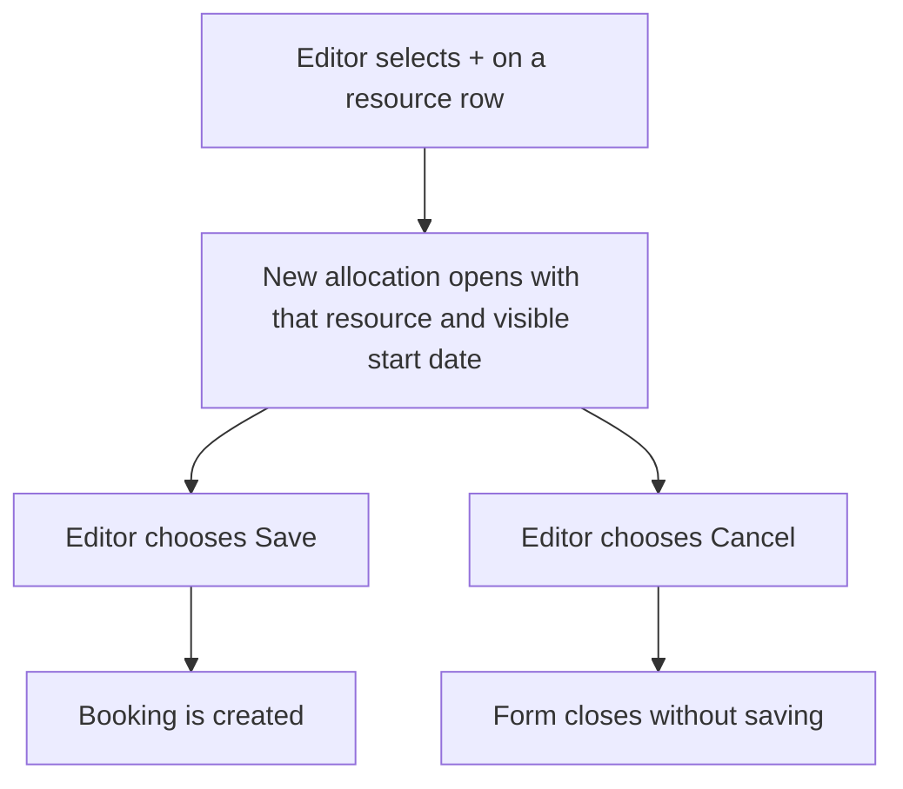
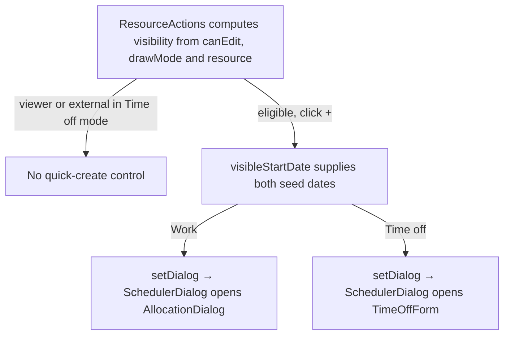

# US-SCH-17 — Quick-create an allocation from a row's "+" button

As an Editor, I want to start an allocation from a resource row so that the correct resource is already selected.

**Status:** Current

**Access:** Editor, Admin or Owner

**Entry:** Schedule (`/`)

**Documentation:** [schedule-work.md](../../docs-src/using/schedule-work.md)

**Source:** [SchedulerGrid.tsx](../../apps/frontend/src/components/scheduler/SchedulerGrid.tsx)

## Acceptance criteria

- In Work draw mode, the row **+** (**Add allocation for {name}**) opens **New allocation for {name}** with that resource fixed and the visible start date as Start and End.
- In Time off draw mode the same control is **Add time off for {name}** and opens the time-off form instead; external resources have no **+** in Time off mode.
- The control appears only for Editors, Admins and Owners.

## User flow

## Code flow

This flow ends at the seeded form. [US-ALL-01](../allocation/US-ALL-01-create.md) and [US-TOF-01](../time-off/US-TOF-01-book-time-off.md) trace Save, cancellation and request outcomes.

**Code references:**

- [SchedulerGridRow.tsx](../../apps/frontend/src/components/scheduler/SchedulerGridRow.tsx#L130)
- [useSchedulerViewport.ts](../../apps/frontend/src/components/scheduler/useSchedulerViewport.ts#L269)
- [SchedulerGrid.tsx](../../apps/frontend/src/components/scheduler/SchedulerGrid.tsx#L39)
- [SchedulerGrid.tsx](../../apps/frontend/src/components/scheduler/SchedulerGrid.tsx#L116)
