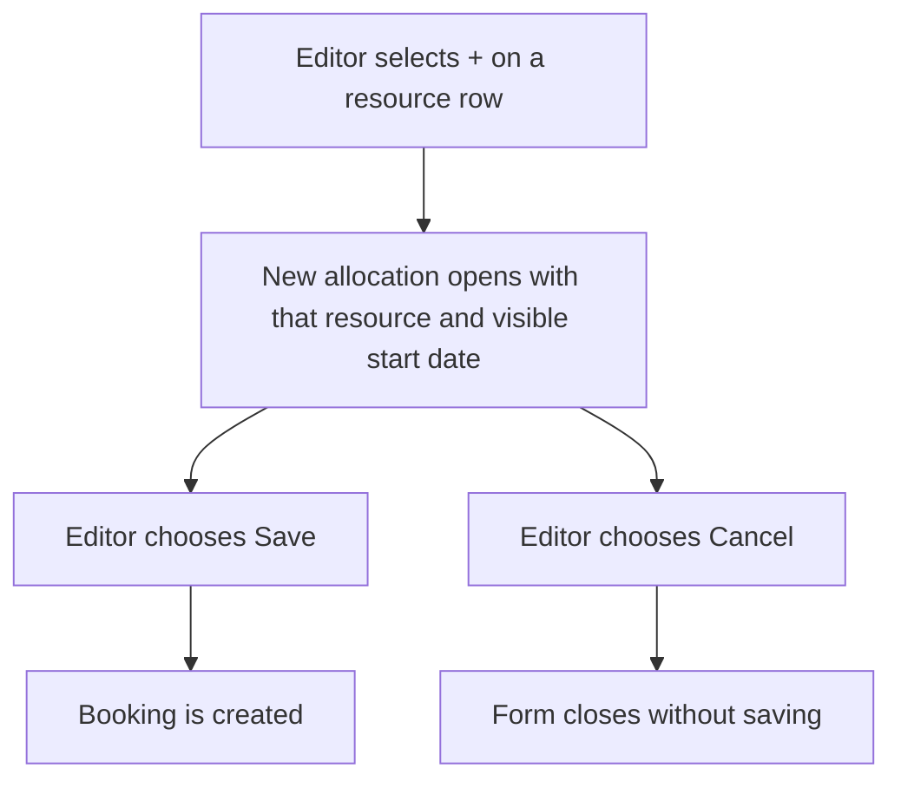
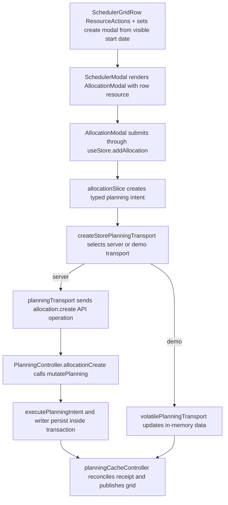

# US-SCH-17 — Quick-create an allocation from a row's "+" button

As an Editor, I want to start an allocation from a resource row so that the correct resource is already selected.

**Status:** Current

**Access:** Editor, Admin or Owner

**Entry:** Schedule (`/`)

**Documentation:** [schedule-work.md](../../docs-src/using/schedule-work.md)

**Source:** [SchedulerGrid.tsx](../../apps/frontend/src/components/scheduler/SchedulerGrid.tsx)

## Acceptance criteria

- In Work draw mode, the row **+** (**Add allocation for {name}**) opens **New allocation for {name}** with that resource fixed and the visible start date as Start and End.
- In Time off draw mode the same control is **Add time off for {name}** and opens the time-off form instead; external resources have no **+** in Time off mode.
- The control appears only for Editors, Admins and Owners.

## User flow

## Code flow

**Code references:** [SchedulerGrid.tsx](../../apps/frontend/src/components/scheduler/SchedulerGrid.tsx), [useResourceLaneInteraction.ts](../../apps/frontend/src/components/scheduler/useResourceLaneInteraction.ts), [SchedulerGridRow.tsx](../../apps/frontend/src/components/scheduler/SchedulerGridRow.tsx), [AllocationModal.tsx](../../apps/frontend/src/components/scheduler/AllocationModal.tsx), [allocationSlice.ts](../../apps/frontend/src/store/slices/allocationSlice.ts), [planningCacheController.ts](../../apps/frontend/src/data/planning/planningCacheController.ts), [storePlanningTransport.ts](../../apps/frontend/src/data/planning/storePlanningTransport.ts), [planningTransport.ts](../../apps/frontend/src/data/planning/planningTransport.ts), [volatilePlanningTransport.ts](../../apps/frontend/src/data/planning/volatilePlanningTransport.ts), [planning_controller.ts](../../apps/backend/app/controllers/planning_controller.ts), [planning.ts](../../apps/backend/app/services/planning.ts), [execute.ts](../../apps/backend/app/services/planning/execute.ts), [writer.ts](../../apps/backend/app/services/planning/writer.ts)
