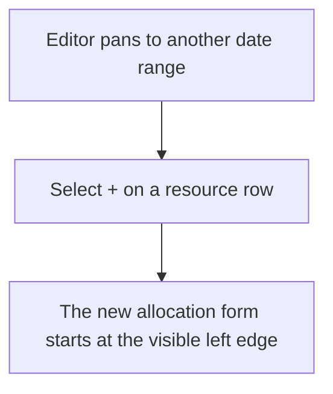
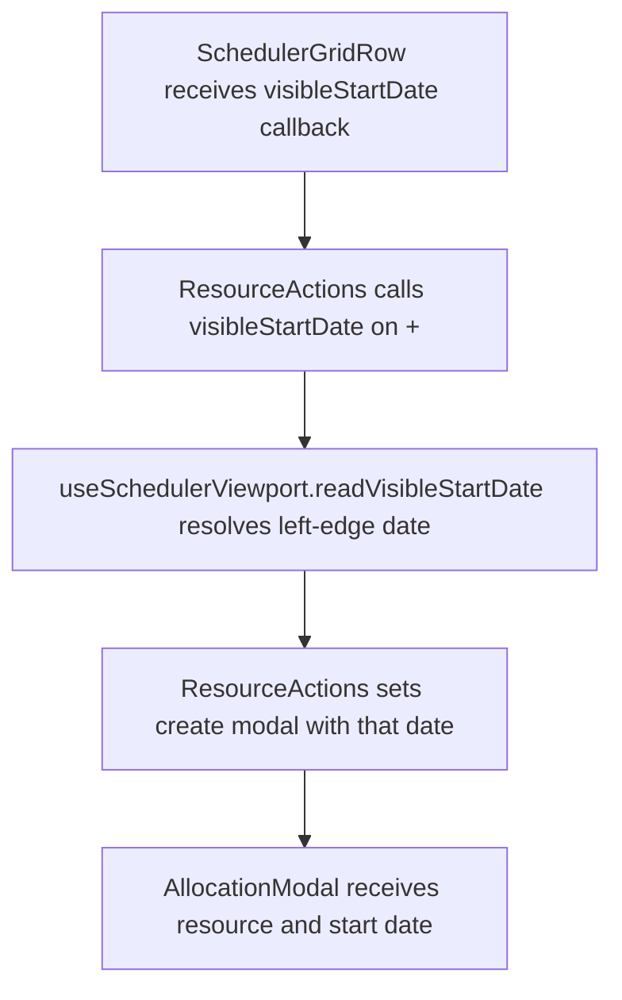

# US-SCH-18 — Quick-create defaults to the date you're looking at

As an Editor, I want quick-create to use the date at the left edge of the visible Schedule so that the default matches the period I am viewing.

**Status:** Current

**Access:** Editor, Admin or Owner

**Entry:** Schedule (`/`)

**Documentation:** [schedule-work.md](../../docs-src/using/schedule-work.md)

**Source:** [SchedulerGrid.tsx](../../apps/frontend/src/components/scheduler/SchedulerGrid.tsx)

## Acceptance criteria

- The row **+** uses the date at the left edge of the visible timeline as the new entry’s Start and End.

## User flow

## Code flow

**Code references:** [SchedulerGridRow.tsx](../../apps/frontend/src/components/scheduler/SchedulerGridRow.tsx), [useSchedulerViewport.ts](../../apps/frontend/src/components/scheduler/useSchedulerViewport.ts), [SchedulerGrid.tsx](../../apps/frontend/src/components/scheduler/SchedulerGrid.tsx), [AllocationModal.tsx](../../apps/frontend/src/components/scheduler/AllocationModal.tsx)
