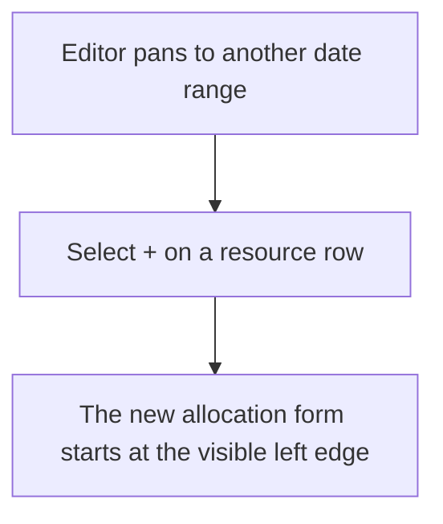
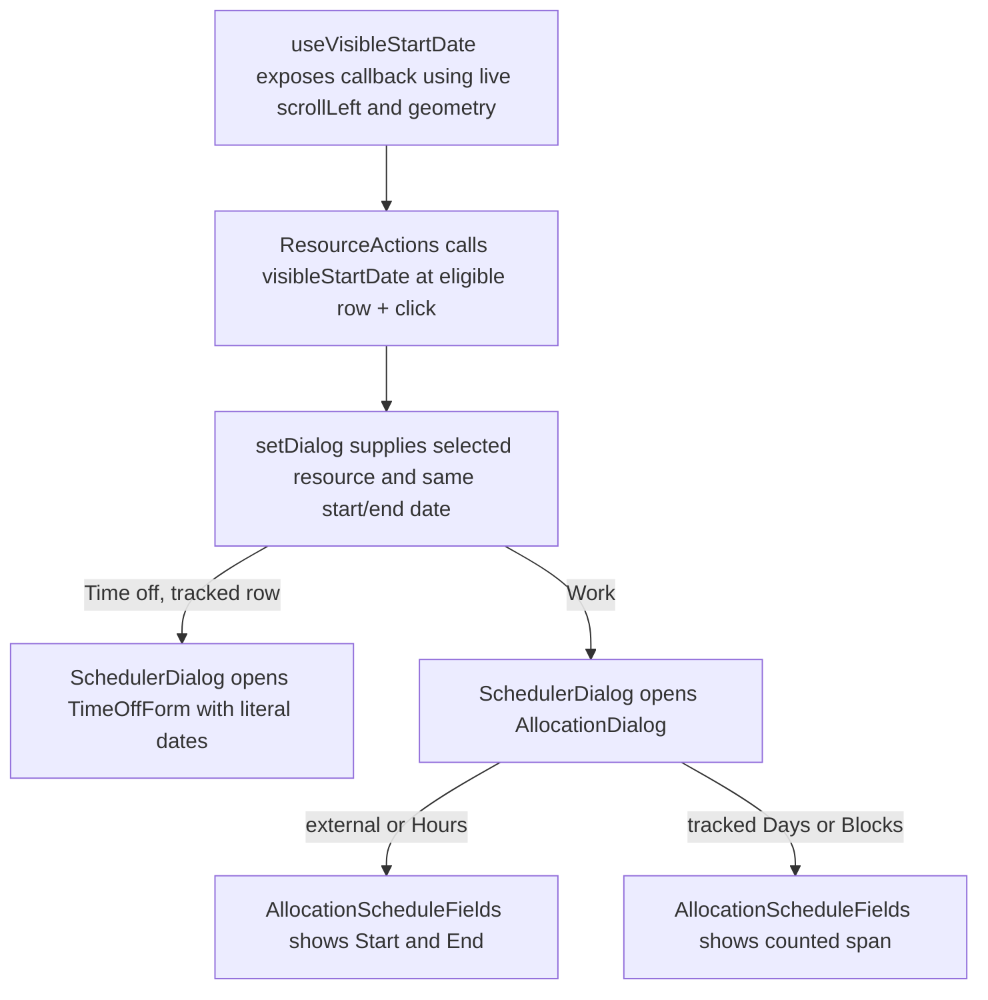

# US-SCH-18 — Quick-create defaults to the date you're looking at

As an Editor, I want quick-create to use the date at the left edge of the visible Schedule so that the default matches the period I am viewing.

**Status:** Current

**Access:** Editor, Admin or Owner

**Entry:** Schedule (`/`)

**Documentation:** [schedule-work.md](../../docs-src/using/schedule-work.md)

**Source:** [SchedulerGrid.tsx](../../apps/frontend/src/components/scheduler/SchedulerGrid.tsx)

## Acceptance criteria

- The row **+** uses the date at the left edge of the visible timeline as the new entry’s Start and End.

## User flow

## Code flow

`useVisibleStartDate` falls back to a materialized date when the live geometry cannot supply one. Time off + is absent for external rows. This flow ends at form initialization. [US-ALL-01](../allocation/US-ALL-01-create.md) and [US-TOF-01](../time-off/US-TOF-01-book-time-off.md) trace persistence and dismissal.

**Code references:**

- [useSchedulerViewport.ts](../../apps/frontend/src/components/scheduler/useSchedulerViewport.ts#L269)
- [useSchedulerViewport.ts](../../apps/frontend/src/components/scheduler/useSchedulerViewport.ts#L376)
- [SchedulerGridRow.tsx](../../apps/frontend/src/components/scheduler/SchedulerGridRow.tsx#L130)
- [SchedulerGrid.tsx](../../apps/frontend/src/components/scheduler/SchedulerGrid.tsx#L39)
- [useAllocationScheduleState.ts](../../apps/frontend/src/components/scheduler/useAllocationScheduleState.ts#L188)
- [AllocationScheduleFields.tsx](../../apps/frontend/src/components/scheduler/AllocationScheduleFields.tsx#L281)
- [useSchedulerViewport.test.tsx](../../apps/frontend/src/components/scheduler/useSchedulerViewport.test.tsx#L72)
