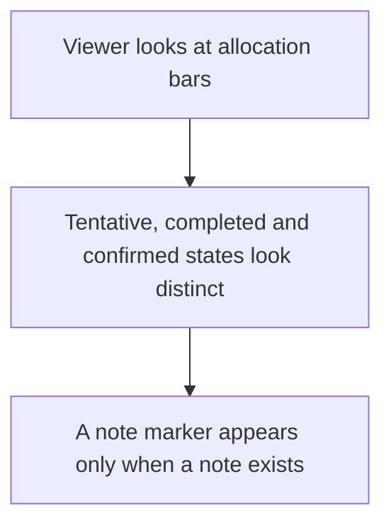
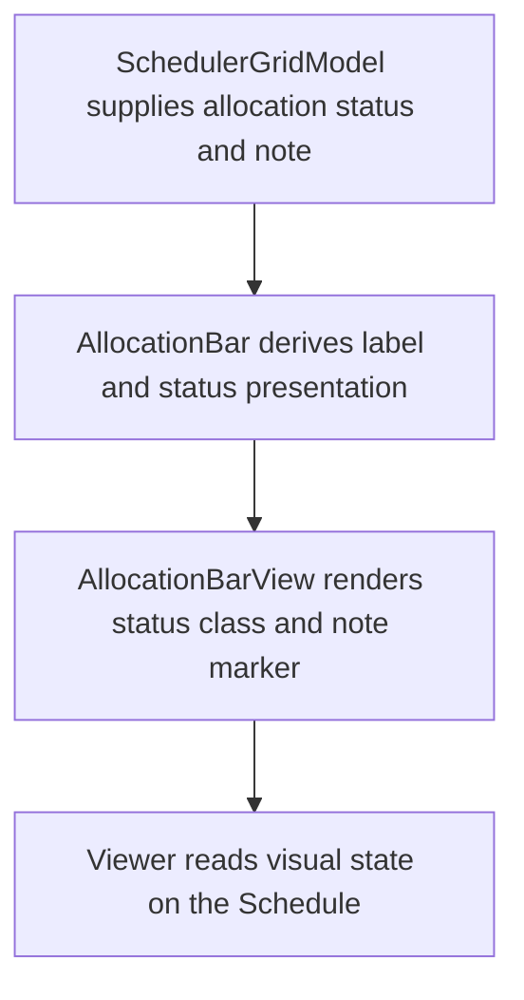

# US-SCH-19 — Allocation status and notes are visually distinct on the bar

As an Editor, I want status and notes to look distinct on allocation bars so that I can read important booking details at a glance.

**Status:** Current

**Access:** Viewer, Editor, Admin or Owner; editing actions require Editor or higher

**Entry:** Schedule (`/`)

**Documentation:** [schedule-work.md](../../docs-src/using/schedule-work.md)

**Source:** [SchedulerGrid.tsx](../../apps/frontend/src/components/scheduler/SchedulerGrid.tsx)

## Acceptance criteria

- Tentative, completed and confirmed allocations have distinct visual treatments.
- A note marker appears only on allocations that have a note.

## User flow

## Code flow

**Code references:** [schedulerModel.ts](../../apps/frontend/src/components/scheduler/schedulerModel.ts), [AllocationBar.tsx](../../apps/frontend/src/components/scheduler/AllocationBar.tsx), [AllocationBarView.tsx](../../apps/frontend/src/components/scheduler/AllocationBarView.tsx)
