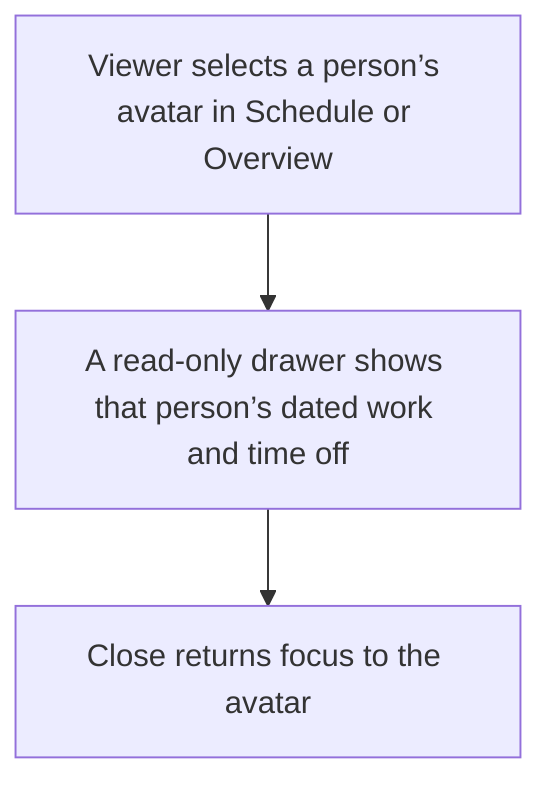
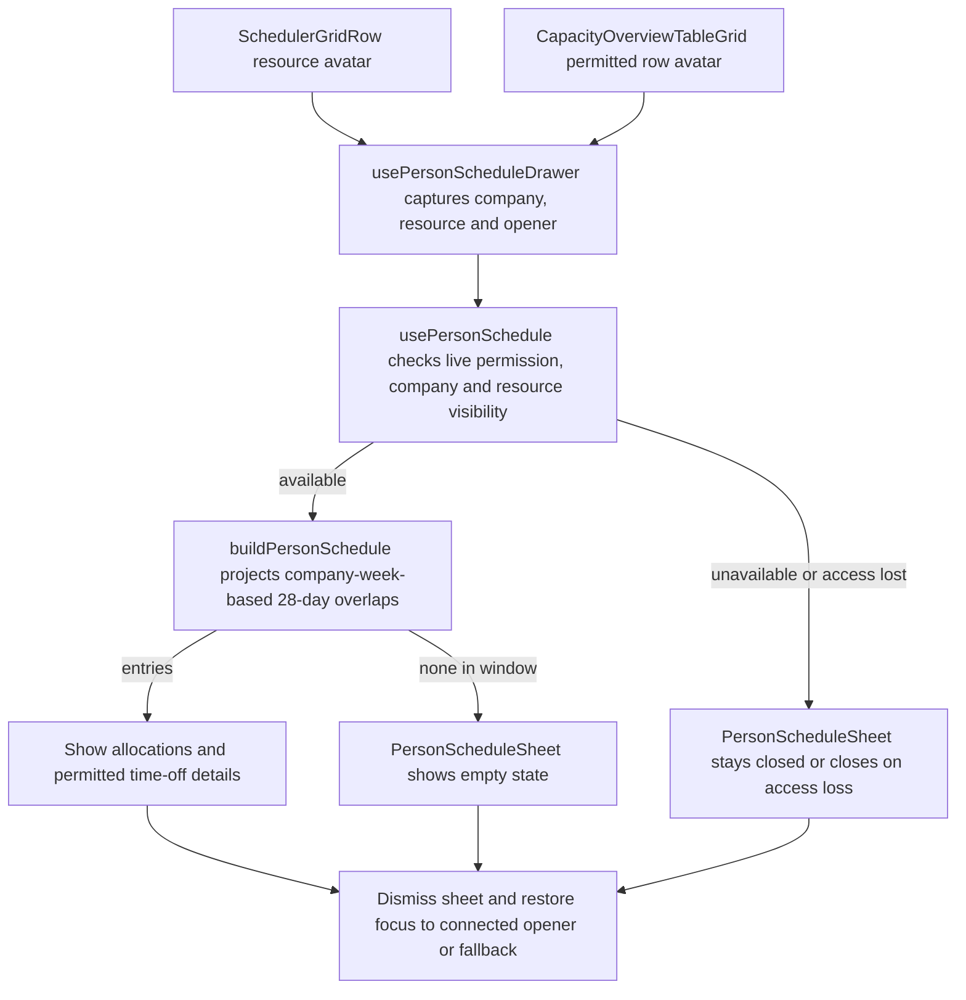

# US-SCH-20 — Open a read-only person schedule

As a company member, I want to open a person’s read-only schedule so that I can review their dated work and time off without leaving the current view.

**Status:** Current

**Access:** Viewer, Editor, Admin or Owner

**Entry:** Schedule resource avatar or Overview person avatar

**Documentation:** [schedule-work.md](../../docs-src/using/schedule-work.md)

**Source:** [PersonScheduleTrigger.tsx](../../apps/frontend/src/components/person-schedule/PersonScheduleTrigger.tsx), [PersonScheduleSheet.tsx](../../apps/frontend/src/components/person-schedule/PersonScheduleSheet.tsx), [PersonScheduleEntry.tsx](../../apps/frontend/src/components/person-schedule/PersonScheduleEntry.tsx)

## Acceptance criteria

- The resource avatar opens a read-only side sheet listing the person’s dated allocations and time off for 28 days from the start of the current company week.
- Closing the sheet returns focus to its avatar.

## User flow

## Code flow

The projection is independent of Schedule zoom or filters and Overview horizon. Tracked resources can have personal time off. Note visibility follows the effective grant.

**Code references:**

- [SchedulerGridRow.tsx](../../apps/frontend/src/components/scheduler/SchedulerGridRow.tsx#L43)
- [CapacityOverviewTableGrid.tsx](../../apps/frontend/src/components/capacity-overview/CapacityOverviewTableGrid.tsx#L83)
- [usePersonScheduleDrawer.ts](../../apps/frontend/src/components/person-schedule/usePersonScheduleDrawer.ts#L14)
- [usePersonSchedule.ts](../../apps/frontend/src/components/person-schedule/usePersonSchedule.ts#L62)
- [personScheduleModel.ts](../../apps/frontend/src/components/person-schedule/personScheduleModel.ts#L113)
- [PersonScheduleSheet.tsx](../../apps/frontend/src/components/person-schedule/PersonScheduleSheet.tsx#L17)
- [usePersonSchedule.test.tsx](../../apps/frontend/src/components/person-schedule/usePersonSchedule.test.tsx#L103)
