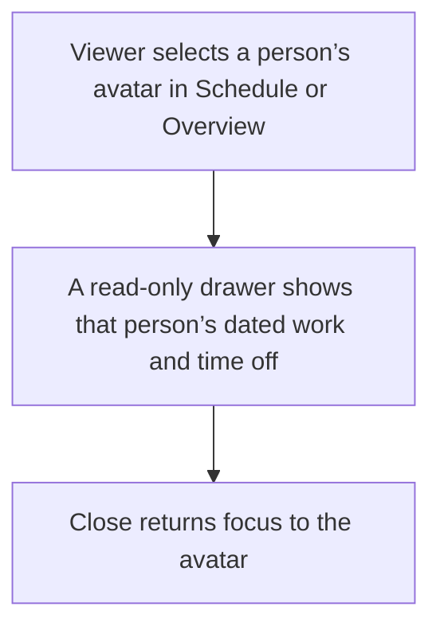
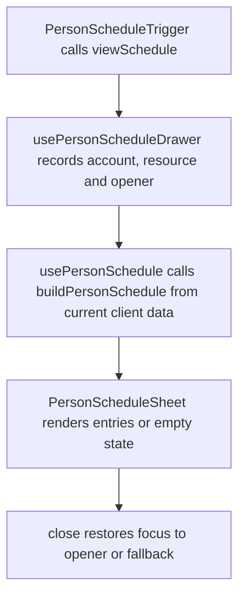

# US-SCH-20 — Open a read-only person schedule

As a company member, I want to open a person’s read-only schedule so that I can review their dated work and time off without leaving the current view.

**Status:** Current

**Access:** Viewer, Editor, Admin or Owner

**Entry:** Schedule resource avatar or Overview person avatar

**Documentation:** [schedule-work.md](../../docs-src/using/schedule-work.md)

**Source:** [PersonScheduleTrigger.tsx](../../apps/frontend/src/components/person-schedule/PersonScheduleTrigger.tsx), [PersonScheduleSheet.tsx](../../apps/frontend/src/components/person-schedule/PersonScheduleSheet.tsx), [PersonScheduleEntry.tsx](../../apps/frontend/src/components/person-schedule/PersonScheduleEntry.tsx)

## Acceptance criteria

- The resource avatar opens a read-only side sheet with a fixed 28-day schedule and dated allocation/time-off entries.
- Closing the sheet returns focus to its avatar.

## User flow

## Code flow

**Code references:** [PersonScheduleTrigger.tsx](../../apps/frontend/src/components/person-schedule/PersonScheduleTrigger.tsx), [usePersonScheduleDrawer.ts](../../apps/frontend/src/components/person-schedule/usePersonScheduleDrawer.ts), [usePersonSchedule.ts](../../apps/frontend/src/components/person-schedule/usePersonSchedule.ts), [personScheduleModel.ts](../../apps/frontend/src/components/person-schedule/personScheduleModel.ts), [PersonScheduleSheet.tsx](../../apps/frontend/src/components/person-schedule/PersonScheduleSheet.tsx), [PersonScheduleEntry.tsx](../../apps/frontend/src/components/person-schedule/PersonScheduleEntry.tsx), [SchedulerGrid.tsx](../../apps/frontend/src/components/scheduler/SchedulerGrid.tsx), [CapacityOverviewTable.tsx](../../apps/frontend/src/components/capacity-overview/CapacityOverviewTable.tsx)
