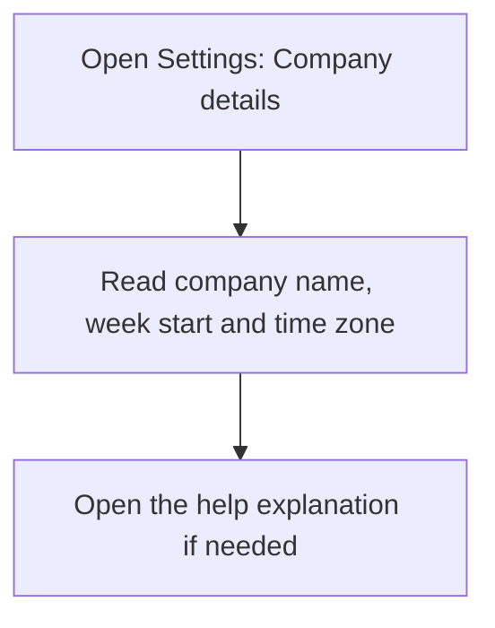
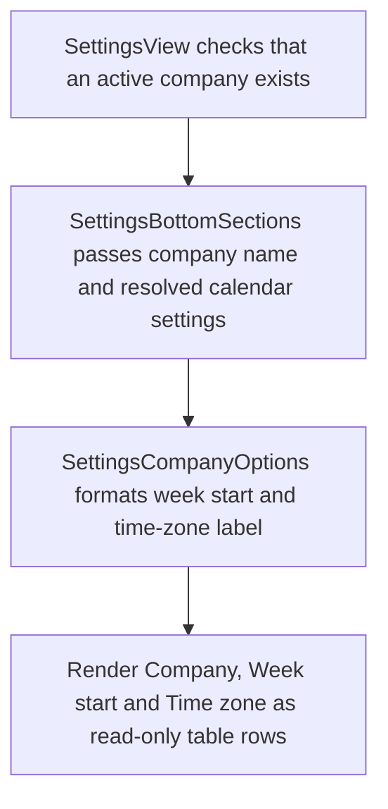

# US-SET-01 — Company details

As a company member, I want to see the company name, week start and time zone so that I can understand the shared calendar context.

**Status:** Current; displayed as a read-only summary.
**Access:** Owner, Admin, Editor, Viewer
**Entry:** Settings → Data and support → Company details
**Documentation:** [Settings](../../docs-src/using/settings.md#calendar)
**Source:** [SettingsCompanySections.tsx](../../apps/frontend/src/components/settings/SettingsCompanySections.tsx)

The values are read-only after setup by decision; a rename control for the company name is deferred ([#2461](https://github.com/Kevinjohn/capacitylens/issues/2461)).

## Acceptance criteria

| Field          | Control        | Required/default/conditions              |
| -------------- | -------------- | ---------------------------------------- |
| Company name   | Read-only text | Selected at company setup.               |
| Week starts on | Read-only text | Monday or Sunday; fixed after creation.  |
| Time zone      | Read-only text | Company time zone; fixed after creation. |

- The question-mark help control explains the company details.

## User flow

## Code flow

This is the Company details read path. Ordinary settings updates freeze the established calendar fields. [US-DAT-02](../data/US-DAT-02-import-json.md#code-flow) traces the separate full-import path that can replace them.

**Code references:** [SettingsView.tsx:45](../../apps/frontend/src/components/settings/SettingsView.tsx#L45) · [SettingsView.tsx:61](../../apps/frontend/src/components/settings/SettingsView.tsx#L61) · [SettingsCompanySections.tsx:12](../../apps/frontend/src/components/settings/SettingsCompanySections.tsx#L12) · [selectors.ts:88](../../apps/frontend/src/store/selectors.ts#L88) · [DECISIONS.md](../../DECISIONS.md#data-and-company-separation) · [company_import_service.ts:165](../../apps/backend/app/services/company_import_service.ts#L165)
