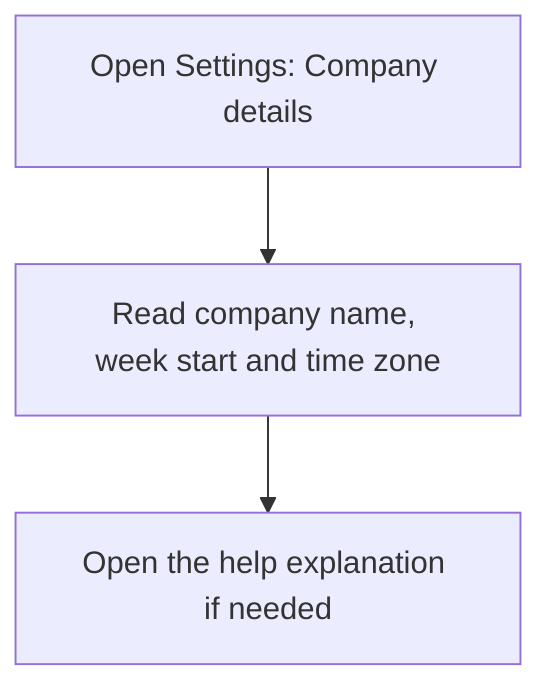
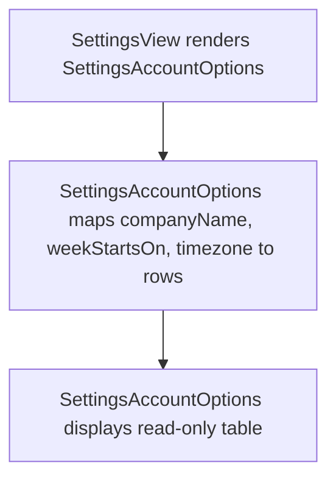

# US-SET-01 — Company details

As a company member, I want to see the company name, week start and time zone so that I can understand the shared calendar context.

**Status:** Current; displayed as a read-only summary.
**Access:** Owner, Admin, Editor, Viewer
**Entry:** Settings → Data and support → Company details
**Documentation:** [Settings](../../docs-src/using/settings.md#calendar)
**Source:** [SettingsAccountSections.tsx](../../apps/frontend/src/components/settings/SettingsAccountSections.tsx)

The read-only values differ from the configuration target; see [GAP-01](../GAPS.md).

## Acceptance criteria

| Field          | Control        | Required/default/conditions              |
| -------------- | -------------- | ---------------------------------------- |
| Company name   | Read-only text | Selected at company setup.               |
| Week starts on | Read-only text | Monday or Sunday; fixed after creation.  |
| Time zone      | Read-only text | Company time zone; fixed after creation. |

- The question-mark help control explains the company details.

## User flow

## Code flow

**Code references:** [SettingsView.tsx](../../apps/frontend/src/components/settings/SettingsView.tsx), [SettingsAccountSections.tsx](../../apps/frontend/src/components/settings/SettingsAccountSections.tsx)
