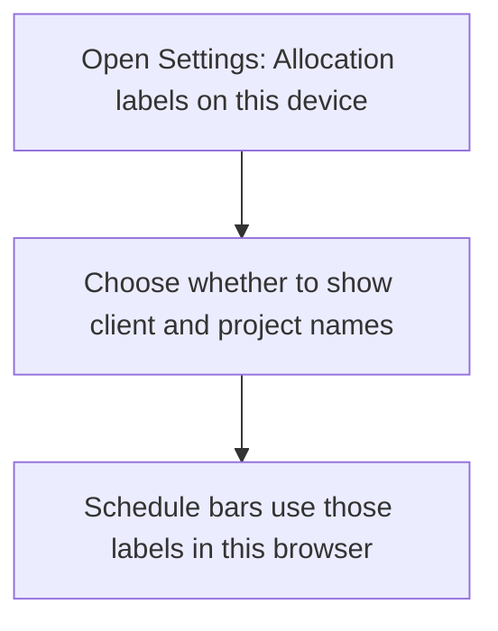
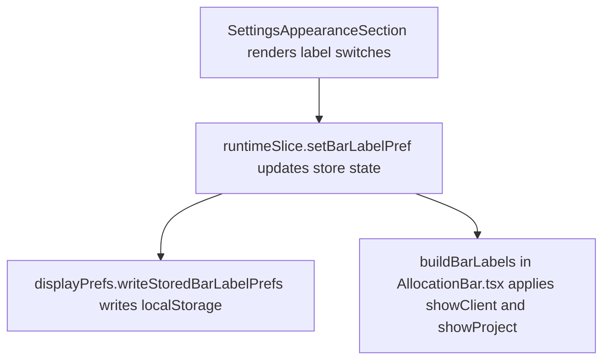

# US-SET-02 — Choose allocation bar labels

As a company member, I want to choose allocation bar labels so that schedule bars show the context I need.

**Status:** Current
**Access:** Owner, Admin, Editor, Viewer
**Entry:** Settings → My display → Allocation labels on this device
**Documentation:** [Settings](../../docs-src/using/settings.md)
**Source:** [SettingsAppearanceSection.tsx](../../apps/frontend/src/components/settings/SettingsAppearanceSection.tsx)

## Acceptance criteria

| Field             | Control | Required/default/conditions      |
| ----------------- | ------- | -------------------------------- |
| Show client name  | Switch  | On by default; this device only. |
| Show project name | Switch  | On by default; this device only. |

## User flow

## Code flow

**Code references:** [SettingsAppearanceSection.tsx](../../apps/frontend/src/components/settings/SettingsAppearanceSection.tsx), [runtimeSlice.ts](../../apps/frontend/src/store/slices/runtimeSlice.ts), [displayPrefs.ts](../../apps/frontend/src/lib/displayPrefs.ts), [AllocationBar.tsx](../../apps/frontend/src/components/scheduler/AllocationBar.tsx)
