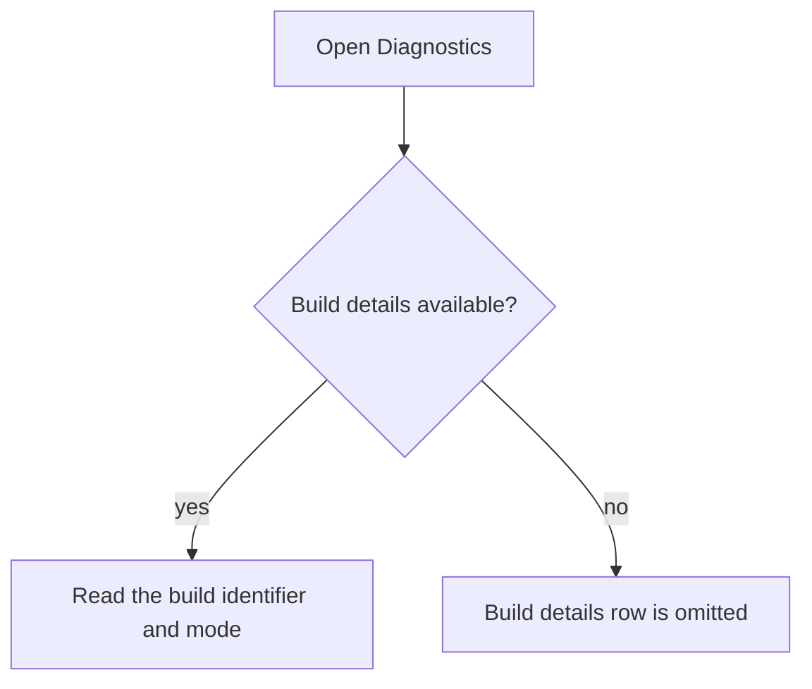
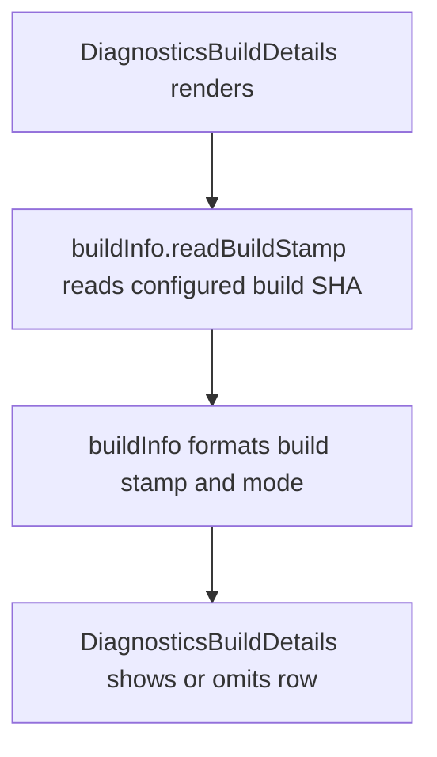

# US-SET-03 — Read build details

As an Owner or Admin, I want to read the build details so that I can identify which version I am using.

**Status:** Current
**Access:** Owner, Admin; anyone in demo mode
**Entry:** Diagnostics → Build details (when configured)
**Documentation:** [Diagnostics](../../docs-src/admin/diagnostics.md)
**Source:** [DiagnosticsBuildDetails.tsx](../../apps/frontend/src/components/diagnostics/DiagnosticsBuildDetails.tsx)

## Acceptance criteria

- With a configured build SHA, Build details shows `build {SHA} · server` or `build {SHA} · demo` as plain text. Without a SHA the stamp is absent, and Build details is omitted when there is also no feedback address.

## User flow

## Code flow

**Code references:** [DiagnosticsBuildDetails.tsx](../../apps/frontend/src/components/diagnostics/DiagnosticsBuildDetails.tsx), [buildInfo.ts](../../apps/frontend/src/data/buildInfo.ts)
