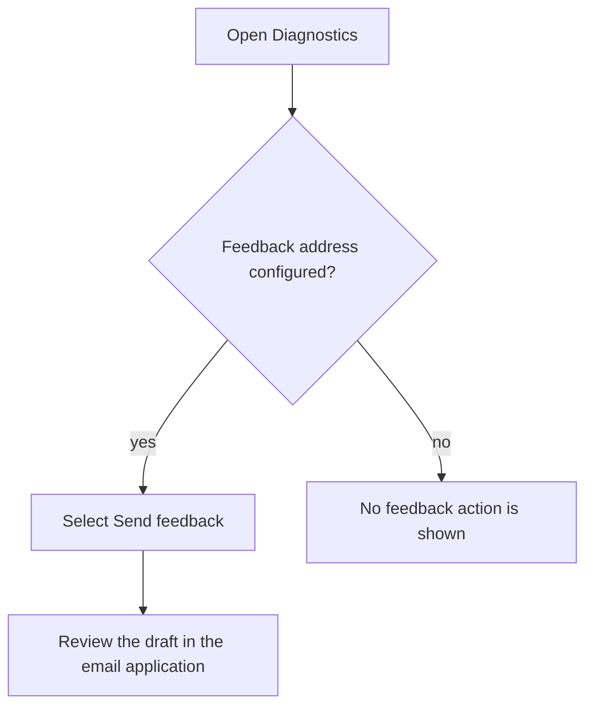
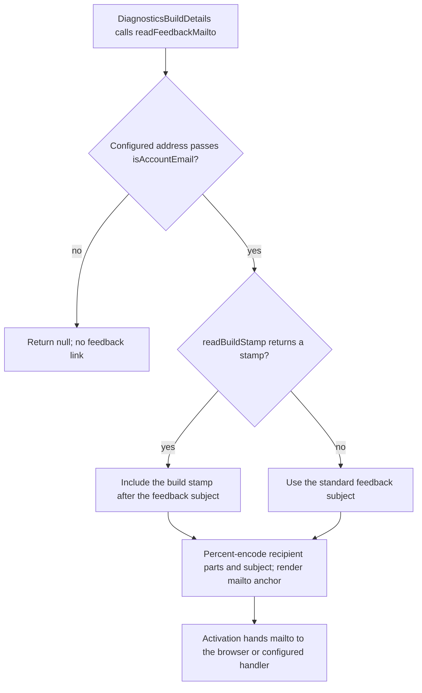

# US-SET-04 — Open a feedback email

As an Owner or Admin, I want to open a preaddressed feedback email so that I can report a problem with its build context.

**Status:** Current
**Access:** Owner, Admin
**Entry:** Diagnostics → Send feedback (when configured)
**Documentation:** [Diagnostics](../../docs-src/admin/diagnostics.md)
**Source:** [DiagnosticsBuildDetails.tsx](../../apps/frontend/src/components/diagnostics/DiagnosticsBuildDetails.tsx)

## Acceptance criteria

- With a configured valid feedback address, **Send feedback** opens a mail draft to that address with the subject `CapacityLens feedback`, followed by the build stamp when one is configured. Without a valid address the link is absent.

## User flow

## Code flow

**Code references:** [DiagnosticsBuildDetails.tsx:19](../../apps/frontend/src/components/diagnostics/DiagnosticsBuildDetails.tsx#L19) · [buildInfo.ts:210](../../apps/frontend/src/data/buildInfo.ts#L210) · [buildInfo.ts:219](../../apps/frontend/src/data/buildInfo.ts#L219)
