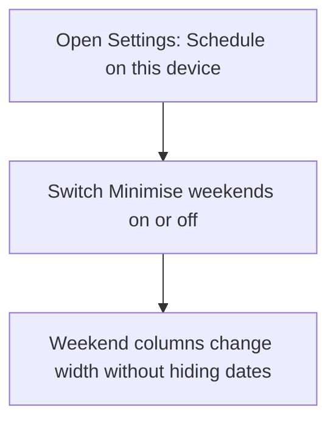
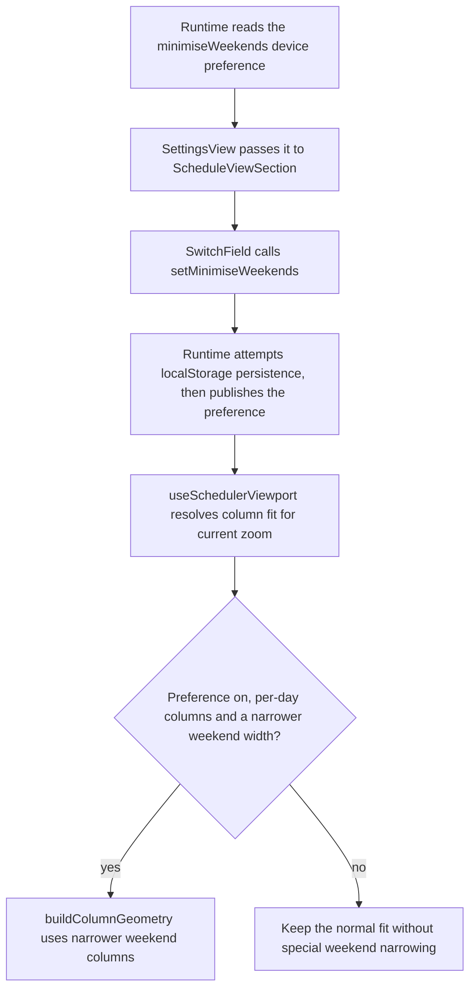

# US-SET-05 — Minimise weekend columns

As a company member, I want to minimise weekend columns so that working days have more room on screen.

**Status:** Current
**Access:** Owner, Admin, Editor, Viewer
**Entry:** Settings → My display → Schedule on this device
**Documentation:** [Settings](../../docs-src/using/settings.md)
**Source:** [SettingsSchedulingSection.tsx](../../apps/frontend/src/components/settings/SettingsSchedulingSection.tsx)

## Acceptance criteria

| Field             | Control | Required/default/conditions                                                                                                                                      |
| ----------------- | ------- | ---------------------------------------------------------------------------------------------------------------------------------------------------------------- |
| Minimise weekends | Switch  | On by default; this device only. Narrows the Saturday and Sunday columns whenever day columns are wider than the narrow weekend width; weekend work still shows. |

## User flow

## Code flow

**Code references:** [SettingsView.tsx:86](../../apps/frontend/src/components/settings/SettingsView.tsx#L86) · [SettingsSchedulingSection.tsx:106](../../apps/frontend/src/components/settings/SettingsSchedulingSection.tsx#L106) · [runtimeSlice.ts:133](../../apps/frontend/src/store/slices/runtimeSlice.ts#L133) · [displayPrefs.ts:200](../../apps/frontend/src/lib/displayPrefs.ts#L200) · [useSchedulerViewport.ts:114](../../apps/frontend/src/components/scheduler/useSchedulerViewport.ts#L114) · [columnGeometry.ts:232](../../apps/frontend/src/components/scheduler/columnGeometry.ts#L232)
