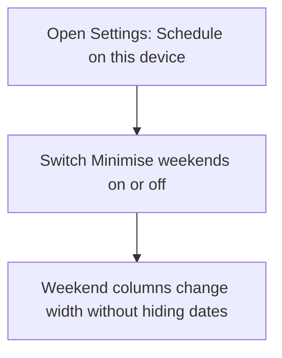
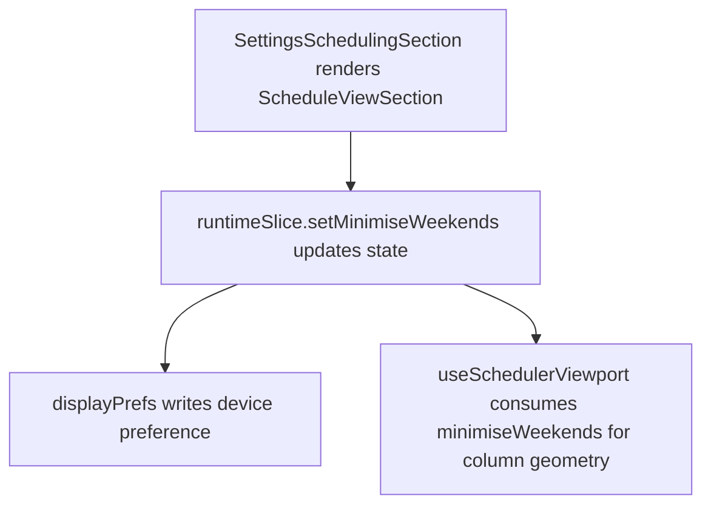

# US-SET-05 — Minimise weekend columns

As a company member, I want to minimise weekend columns so that working days have more room on screen.

**Status:** Current
**Access:** Owner, Admin, Editor, Viewer
**Entry:** Settings → My display → Schedule on this device
**Documentation:** [Settings](../../docs-src/using/settings.md)
**Source:** [SettingsSchedulingSection.tsx](../../apps/frontend/src/components/settings/SettingsSchedulingSection.tsx)

## Acceptance criteria

| Field             | Control | Required/default/conditions                                                 |
| ----------------- | ------- | --------------------------------------------------------------------------- |
| Minimise weekends | Switch  | On by default; this device only. Narrows weekend columns at day-level zoom. |

## User flow

## Code flow

**Code references:** [SettingsSchedulingSection.tsx](../../apps/frontend/src/components/settings/SettingsSchedulingSection.tsx), [runtimeSlice.ts](../../apps/frontend/src/store/slices/runtimeSlice.ts), [displayPrefs.ts](../../apps/frontend/src/lib/displayPrefs.ts), [useSchedulerViewport.ts](../../apps/frontend/src/components/scheduler/useSchedulerViewport.ts)
