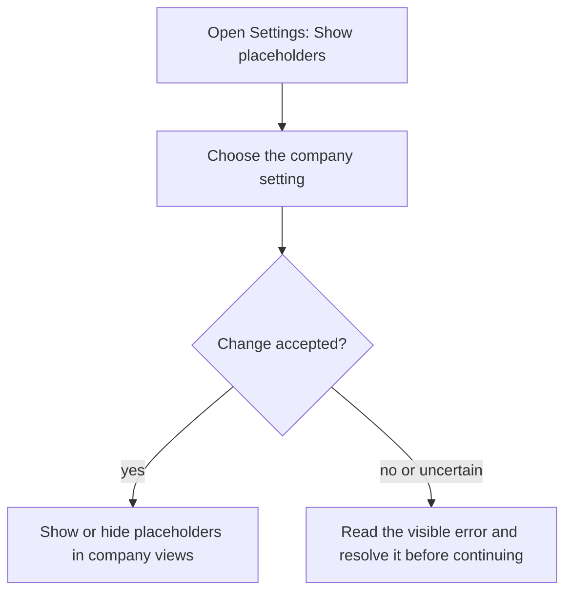
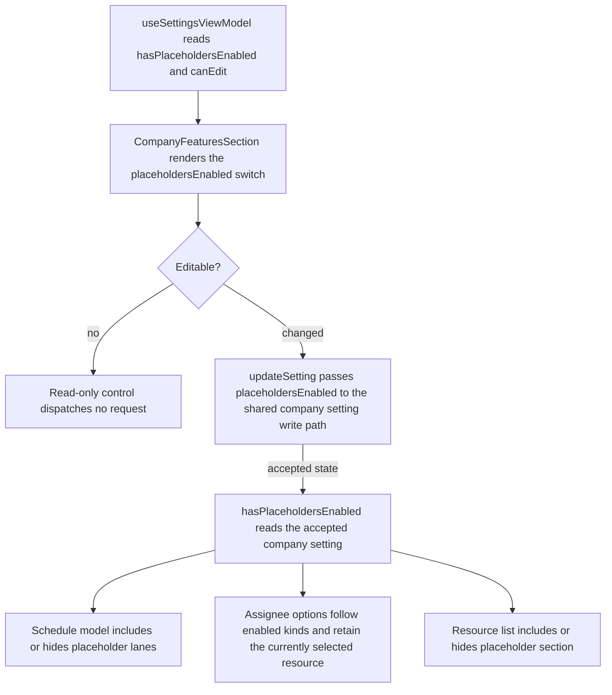

# US-SET-06 — Show placeholders

As an Editor, I want to show or hide placeholders so that I can focus on the resources relevant to my plan.

**Status:** Current
**Access:** Editor and above; Viewers can read the setting.
**Entry:** Settings → Scheduling features → Show placeholders
**Documentation:** [Settings](../../docs-src/using/settings.md)
**Source:** [SettingsSchedulingSection.tsx](../../apps/frontend/src/components/settings/SettingsSchedulingSection.tsx)

## Acceptance criteria

| Field             | Control | Required/default/conditions                                       |
| ----------------- | ------- | ----------------------------------------------------------------- |
| Show placeholders | Switch  | Off for new companies; company-wide. Hidden records are retained. |

## User flow

## Code flow

The [company setting write path](../REFERENCE.md#company-setting-writes) traces the common no-op, server commit, refusal and reconciliation branches.

**Code references:** [useSettingsViewModel.ts:55](../../apps/frontend/src/components/settings/useSettingsViewModel.ts#L55) · [SettingsSchedulingSection.tsx:159](../../apps/frontend/src/components/settings/SettingsSchedulingSection.tsx#L159) · [selectors.ts:63](../../apps/frontend/src/store/selectors.ts#L63) · [useSchedulerGridModel.ts:155](../../apps/frontend/src/components/scheduler/useSchedulerGridModel.ts#L155) · [useAllocationDialogState.ts:85](../../apps/frontend/src/components/scheduler/useAllocationDialogState.ts#L85) · [useAllocationTargetState.ts:54](../../apps/frontend/src/components/scheduler/useAllocationTargetState.ts#L54) · [useResourceListModel.ts:52](../../apps/frontend/src/components/resources/useResourceListModel.ts#L52)
