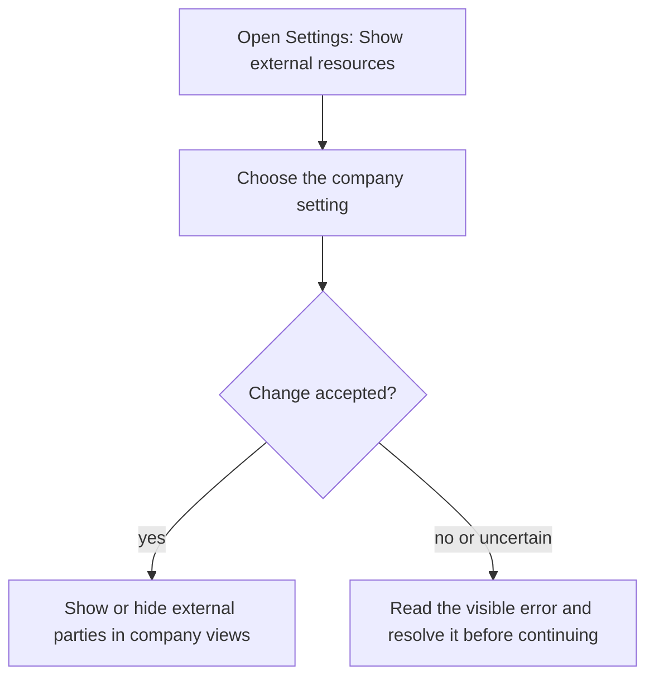
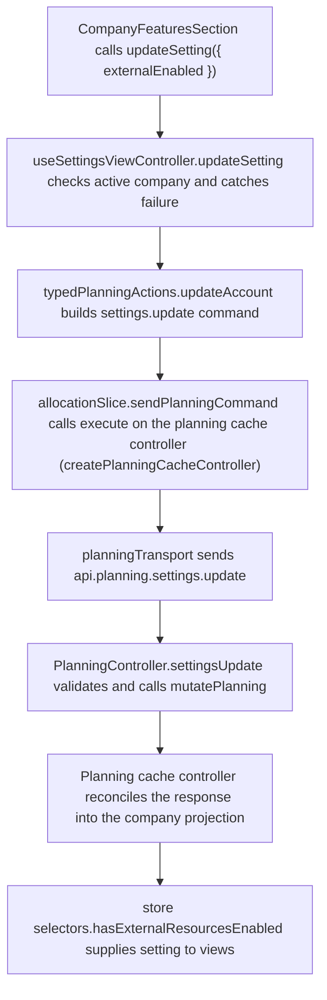

# US-SET-07 — Show external resources

As an Editor, I want to show or hide external resources so that I can focus on the work my company manages.

**Status:** Current
**Access:** Editor and above; Viewers can read the setting.
**Entry:** Settings → Scheduling features → Show external resources
**Documentation:** [Settings](../../docs-src/using/settings.md)
**Source:** [SettingsSchedulingSection.tsx](../../apps/frontend/src/components/settings/SettingsSchedulingSection.tsx)

## Acceptance criteria

| Field                   | Control | Required/default/conditions                                       |
| ----------------------- | ------- | ----------------------------------------------------------------- |
| Show external resources | Switch  | Off for new companies; company-wide. Hidden records are retained. |

## User flow

## Code flow

**Code references:** [SettingsSchedulingSection.tsx](../../apps/frontend/src/components/settings/SettingsSchedulingSection.tsx), [useSettingsViewController.ts](../../apps/frontend/src/components/settings/useSettingsViewController.ts), [typedPlanningActions.ts](../../apps/frontend/src/store/typedPlanningActions.ts), [allocationSlice.ts](../../apps/frontend/src/store/slices/allocationSlice.ts), [planningCacheController.ts](../../apps/frontend/src/data/planning/planningCacheController.ts), [planningTransport.ts](../../apps/frontend/src/data/planning/planningTransport.ts), [planning_routes.ts](../../apps/backend/start/planning_routes.ts), [planning_controller.ts](../../apps/backend/app/controllers/planning_controller.ts), [planning.ts](../../apps/backend/app/services/planning.ts), [selectors.ts](../../apps/frontend/src/store/selectors.ts)
