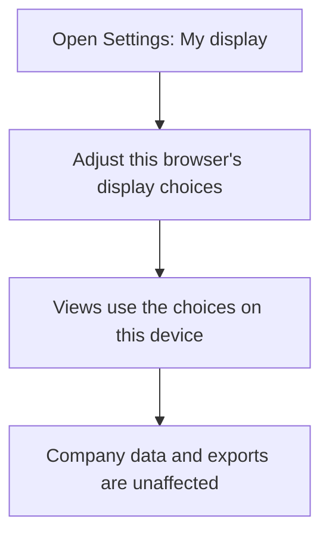
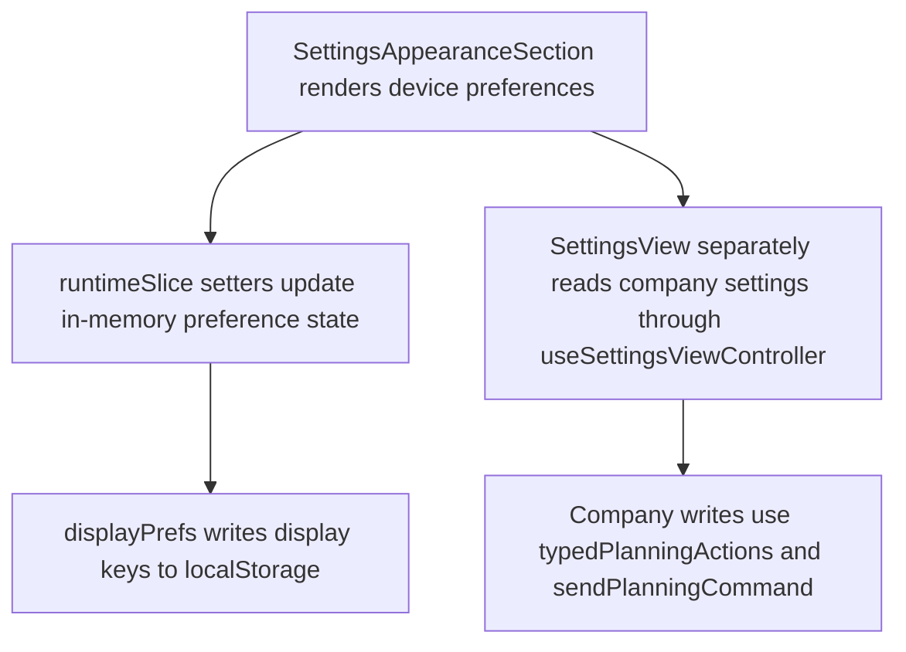

# US-SET-08 — Keep device preferences separate

As a company member, I want to keep display preferences on my device so that they do not change company data or appear in exports.

**Status:** Current
**Access:** Owner, Admin, Editor, Viewer
**Entry:** Settings → My display
**Documentation:** [Settings](../../docs-src/using/settings.md)
**Source:** [SettingsView.tsx](../../apps/frontend/src/components/settings/SettingsView.tsx)

## Acceptance criteria

- Device display preferences stay outside company exports. Scheduling records are never browser-persisted as a failed-read fallback; there is no clear-storage action.

## User flow

## Code flow

**Code references:** [SettingsAppearanceSection.tsx](../../apps/frontend/src/components/settings/SettingsAppearanceSection.tsx), [runtimeSlice.ts](../../apps/frontend/src/store/slices/runtimeSlice.ts), [displayPrefs.ts](../../apps/frontend/src/lib/displayPrefs.ts), [useSettingsViewController.ts](../../apps/frontend/src/components/settings/useSettingsViewController.ts), [typedPlanningActions.ts](../../apps/frontend/src/store/typedPlanningActions.ts)
