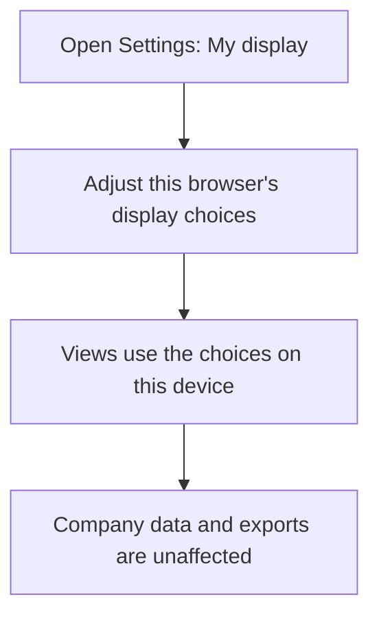
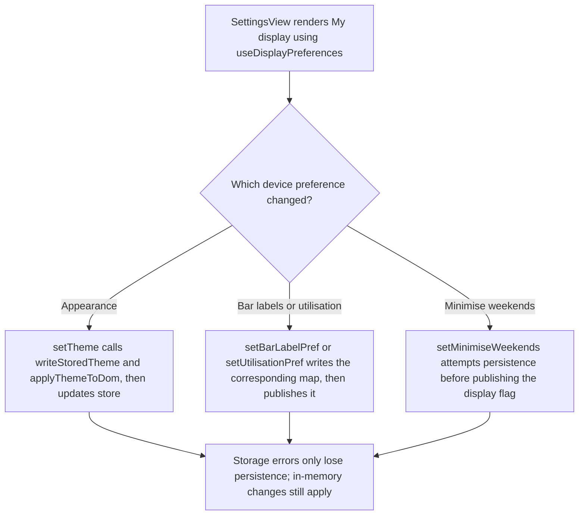

# US-SET-08 — Keep device preferences separate

As a company member, I want to keep display preferences on my device so that they do not change company data or appear in exports.

**Status:** Current
**Access:** Owner, Admin, Editor, Viewer
**Entry:** Settings → My display
**Documentation:** [Settings](../../docs-src/using/settings.md)
**Source:** [SettingsView.tsx](../../apps/frontend/src/components/settings/SettingsView.tsx)

## Acceptance criteria

- Device display preferences stay outside company exports. Scheduling records are never browser-persisted as a failed-read fallback; Settings has no clear-storage action.

## User flow

## Code flow

The company settings mutation follows the [shared write path](../REFERENCE.md#company-setting-writes), outside these device preferences.

**Code references:** [SettingsView.tsx:86](../../apps/frontend/src/components/settings/SettingsView.tsx#L86) · [runtimeSlice.ts:111](../../apps/frontend/src/store/slices/runtimeSlice.ts#L111) · [displayPrefs.ts:32](../../apps/frontend/src/lib/displayPrefs.ts#L32) · [theme.ts:25](../../apps/frontend/src/lib/theme.ts#L25) · [DECISIONS.md](../../DECISIONS.md#data-and-company-separation)
