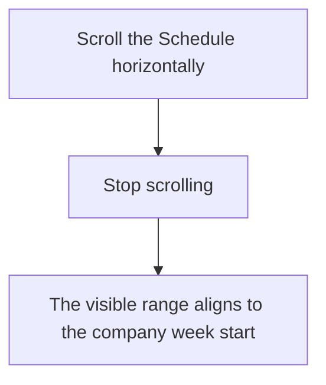
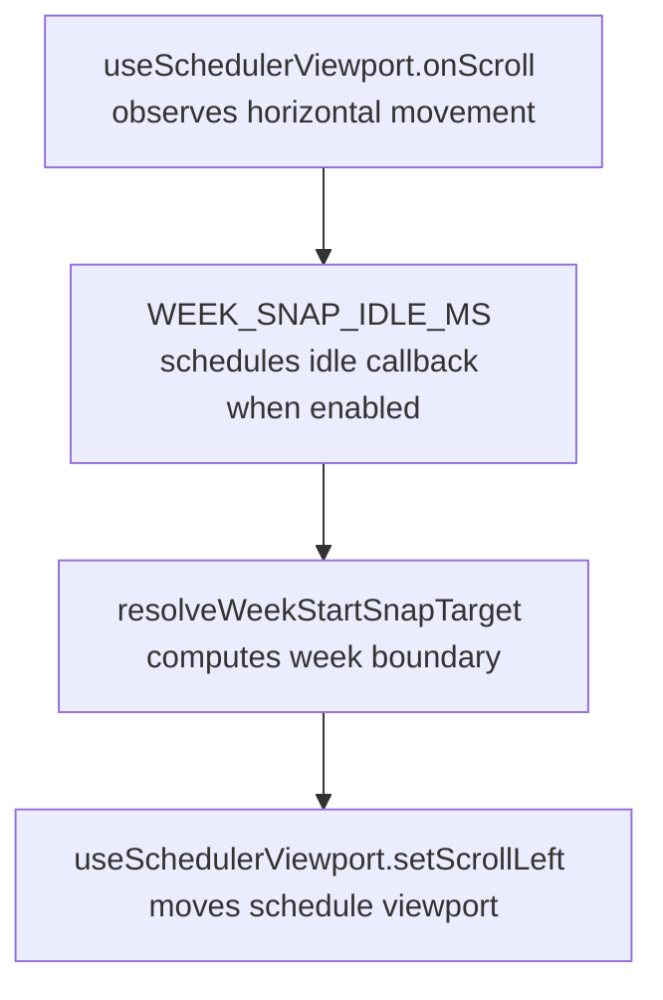

# US-SET-09 — Snap the schedule to week boundaries

As a company member, I want the schedule to align to week boundaries so that weekly planning stays easy to read.

**Status:** Current — automatic Schedule behavior; no Settings switch.
**Access:** Owner, Admin, Editor, Viewer
**Entry:** Schedule horizontal scrolling
**Documentation:** [Schedule](../../docs-src/using/read-the-schedule.md)
**Source:** [useSchedulerViewport.ts](../../apps/frontend/src/components/scheduler/useSchedulerViewport.ts), [displayPrefs.ts](../../apps/frontend/src/lib/displayPrefs.ts)

## Acceptance criteria

- After horizontal scrolling settles, the schedule aligns its left edge to the start of the company week.
- This happens automatically; there is no Settings switch.

## User flow

## Code flow

**Code references:** [useSchedulerViewport.ts](../../apps/frontend/src/components/scheduler/useSchedulerViewport.ts), [resolveWeekStartSnapTarget.ts](../../apps/frontend/src/components/scheduler/resolveWeekStartSnapTarget.ts), [displayPrefs.ts](../../apps/frontend/src/lib/displayPrefs.ts)
