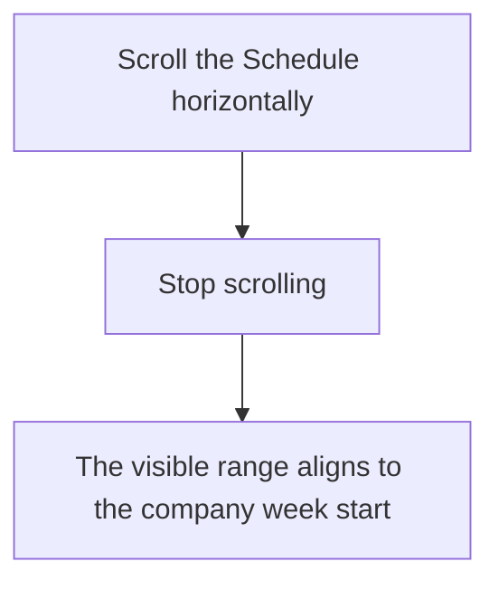
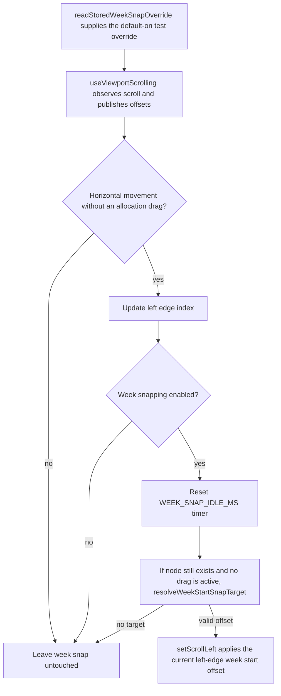

# US-SET-09 — Snap the schedule to week boundaries

As a company member, I want the schedule to align to week boundaries so that weekly planning stays easy to read.

**Status:** Current — automatic Schedule behaviour; no Settings switch.
**Access:** Owner, Admin, Editor, Viewer
**Entry:** Schedule horizontal scrolling
**Documentation:** [Schedule](../../docs-src/using/read-the-schedule.md)
**Source:** [useSchedulerViewport.ts](../../apps/frontend/src/components/scheduler/useSchedulerViewport.ts), [displayPrefs.ts](../../apps/frontend/src/lib/displayPrefs.ts)

## Acceptance criteria

- After horizontal scrolling settles, the schedule aligns its left edge to the start of the company week.
- This happens automatically; there is no Settings switch.

## User flow

## Code flow

Date navigation follows its own company-week path, described in [US-TBR-08](../toolbar/US-TBR-08-week-start-snap.md#code-flow).

**Code references:** [displayPrefs.ts:207](../../apps/frontend/src/lib/displayPrefs.ts#L207) · [runtimeSlice.ts:77](../../apps/frontend/src/store/slices/runtimeSlice.ts#L77) · [useSchedulerViewport.ts:279](../../apps/frontend/src/components/scheduler/useSchedulerViewport.ts#L279) · [resolveWeekStartSnapTarget.ts:23](../../apps/frontend/src/components/scheduler/resolveWeekStartSnapTarget.ts#L23)
