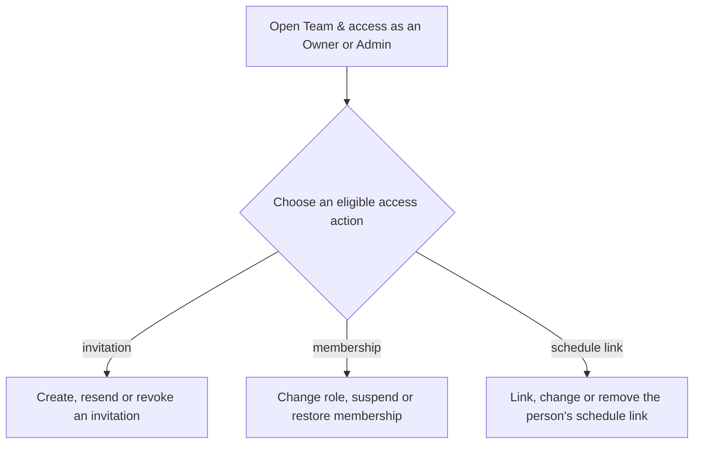
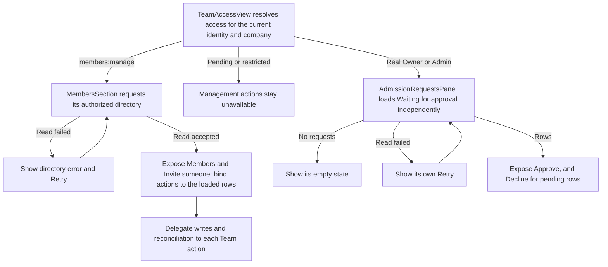

# US-SET-10 — Manage members and invitations

As an Owner or Admin, I want to manage member access and invitations so that only approved teammates can use the company.

**Status:** Current — use US-TEAM stories for individual actions.
**Access:** Owner, Admin
**Entry:** Team & access → Members
**Documentation:** [Invite teammates](../../docs-src/admin/invite-teammates.md)
**Source:** [MembersSection.tsx](../../apps/frontend/src/components/team/MembersSection.tsx)

## Acceptance criteria

- Owner/Admin entry leads to member and invitation actions; see [US-TEAM-02](../team/US-TEAM-02-invite-member.md) through [US-TEAM-07](../team/US-TEAM-07-link-resource.md).
- The **Members** heading has no intro line. The **Invite someone** section has no intro paragraph; its explanation is the invitation dialog description. **Waiting for approval** explains approval only while a request is listed; otherwise it shows "Nobody is waiting for approval."

## User flow

## Code flow

See the [Team actions](../team/US-TEAM-01-check-access.md#code-flow) and [admission decisions](US-SET-19-company-admission.md#code-flow) for write boundaries.

**Code references:** [TeamAccessView.tsx](../../apps/frontend/src/components/team/TeamAccessView.tsx#L131) · [TeamAccessView.tsx](../../apps/frontend/src/components/team/TeamAccessView.tsx#L188) · [MembersSection.tsx](../../apps/frontend/src/components/team/MembersSection.tsx#L28) · [MembersSection.tsx](../../apps/frontend/src/components/team/MembersSection.tsx#L260) · [AdmissionRequestsPanel.tsx](../../apps/frontend/src/components/team/AdmissionRequestsPanel.tsx#L74)
