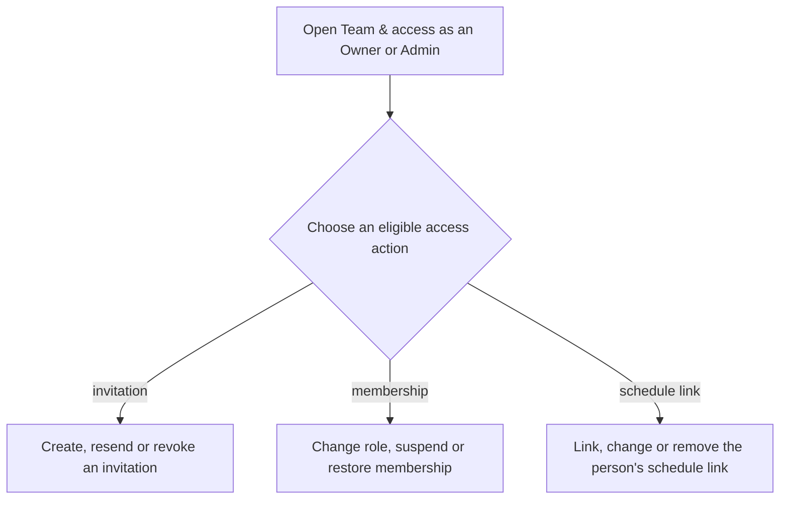
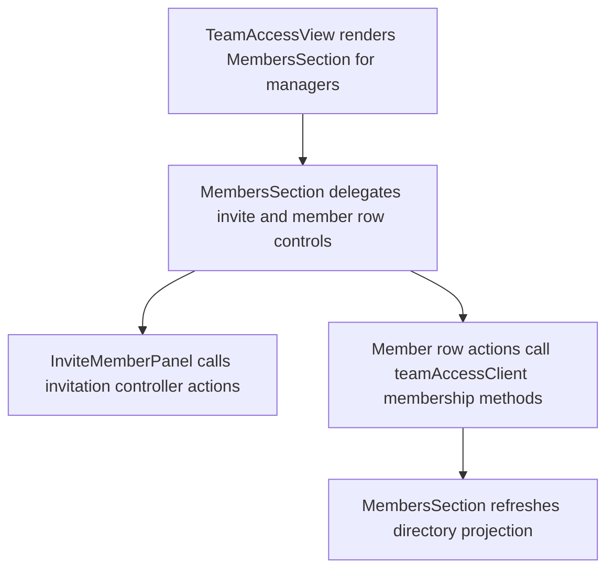

# US-SET-10 — Manage members and invitations

As an Owner or Admin, I want to manage member access and invitations so that only approved teammates can use the company.

**Status:** Current — use US-TEAM stories for individual actions.
**Access:** Owner, Admin
**Entry:** Team & access → Members
**Documentation:** [Invite teammates](../../docs-src/admin/invite-teammates.md)
**Source:** [MembersSection.tsx](../../apps/frontend/src/components/team/MembersSection.tsx)

## Acceptance criteria

- Owner/Admin entry leads to member and invitation actions; see [US-TEAM-02](../team/US-TEAM-02-invite-member.md) through [US-TEAM-07](../team/US-TEAM-07-link-resource.md).

## User flow

## Code flow

**Code references:** [TeamAccessView.tsx](../../apps/frontend/src/components/team/TeamAccessView.tsx), [MembersSection.tsx](../../apps/frontend/src/components/team/MembersSection.tsx), [InviteMemberPanel.tsx](../../apps/frontend/src/components/team/InviteMemberPanel.tsx), [teamAccessClient.ts](../../apps/frontend/src/account/teamAccessClient.ts)
