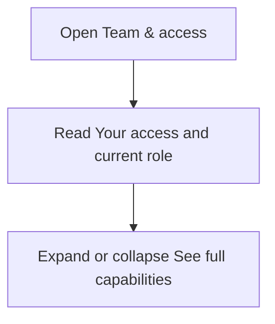
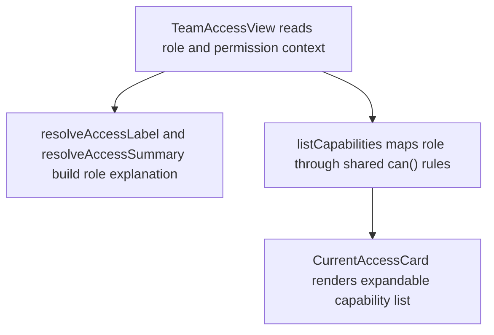

# US-SET-11 — View role capabilities

As a company member, I want to review my role capabilities so that I know what I can do in this company.

**Status:** Current — detailed access actions live in Team & access.
**Access:** Owner, Admin, Editor, Viewer
**Entry:** Team & access → Your access
**Documentation:** [Team & access](../../docs-src/using/team-access.md)
**Source:** [TeamAccessView.tsx](../../apps/frontend/src/components/team/TeamAccessView.tsx)

## Acceptance criteria

- Every member can review their role and capability summary. Server authorization independently controls access.

## User flow

## Code flow

**Code references:** [TeamAccessView.tsx](../../apps/frontend/src/components/team/TeamAccessView.tsx), [accessCopy.ts](../../apps/frontend/src/lib/accessCopy.ts), [access.ts](../../packages/shared/src/domain/access.ts)
