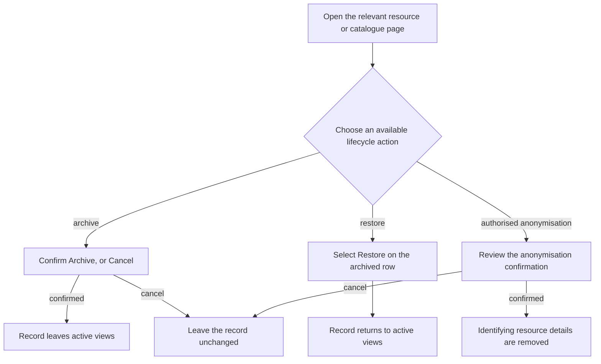
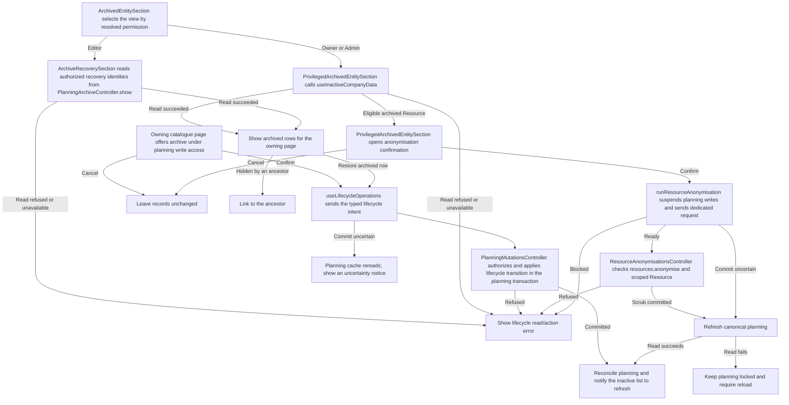

# US-SET-12 — Archive and anonymise records

As a company Editor, I want to archive records and authorised staff to anonymise people so that obsolete or identifying information is handled appropriately.

**Status:** Current — catalogue lifecycle is covered by its owning stories.
**Access:** Owner, Admin, Editor
**Entry:** Resource, Client, Project or Activity archive controls; Settings → Anonymise all people
**Documentation:** [Settings](../../docs-src/using/settings.md)
**Source:** [CompanyAnonymiseSection.tsx](../../apps/frontend/src/components/settings/CompanyAnonymiseSection.tsx)

## Acceptance criteria

- Restore archived records from their owning pages. Individual resource anonymisation is Owner/Admin; company-wide anonymisation is Owner-only with password confirmation. See [US-RES-16](../resources/US-RES-16-anonymise-resource.md).

## User flow

## Code flow

See [Anonymise all people](US-SET-26-anonymise-all-people.md#code-flow) for the separate Owner-only company operation.

**Code references:** [ArchivedEntitySection.tsx](../../apps/frontend/src/components/common/ArchivedEntitySection.tsx#L182) · [CompanyStateController](../../apps/backend/app/controllers/company_state_controller.ts#L14) · [ArchiveRecoverySection.tsx](../../apps/frontend/src/components/common/ArchiveRecoverySection.tsx#L26) · [ArchiveRecoverySection.tsx](../../apps/frontend/src/components/common/ArchiveRecoverySection.tsx#L61) · [useLifecycleOperations.ts](../../apps/frontend/src/hooks/useLifecycleOperations.ts#L51) · [planning_archive_controller.ts](../../apps/backend/app/controllers/planning_archive_controller.ts#L8) · [execute.ts](../../apps/backend/app/services/planning/execute.ts#L71) · [resource_anonymisations_controller.ts](../../apps/backend/app/controllers/resource_anonymisations_controller.ts#L20) · [archive_recovery.spec.ts](../../apps/backend/tests/functional/planning/archive_recovery.spec.ts#L355) · [resourceAnonymisation.ts](../../apps/frontend/src/store/resourceAnonymisation.ts#L26)
