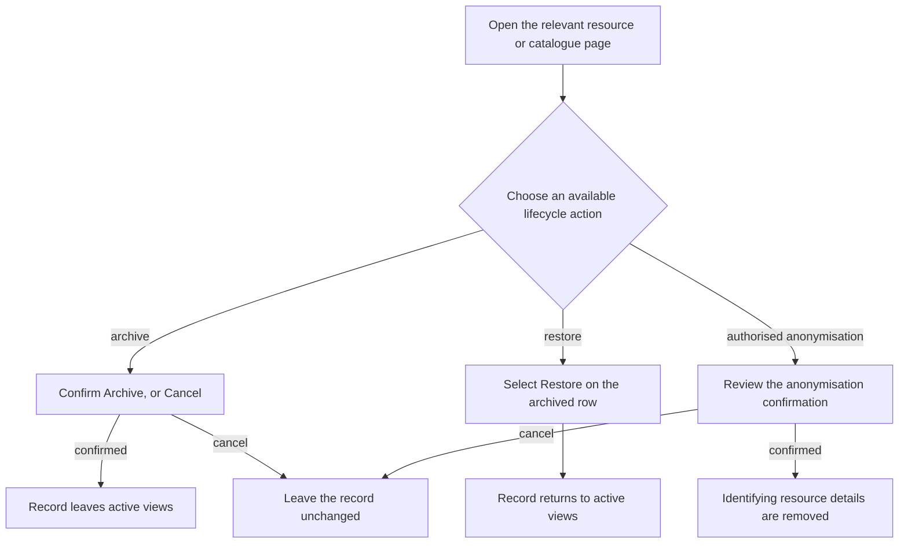
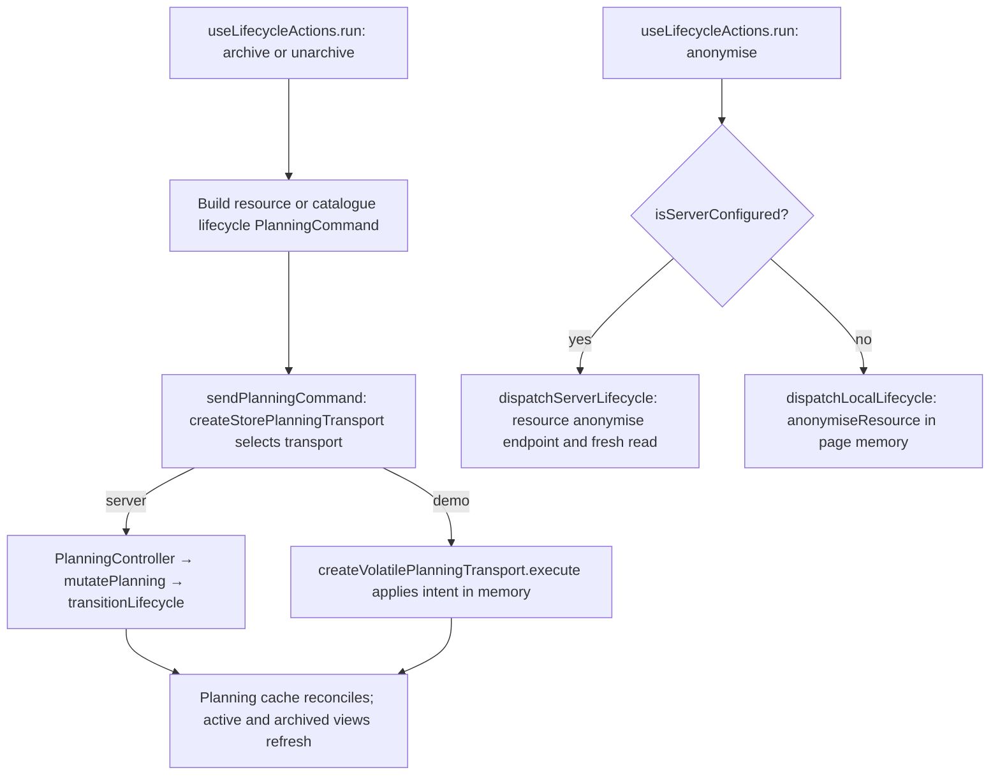

# US-SET-12 — Archive and anonymise records

As a company Editor, I want to archive records and authorised staff to anonymise people so that obsolete or identifying information is handled appropriately.

**Status:** Current — catalogue lifecycle is covered by its owning stories.
**Access:** Owner, Admin, Editor
**Entry:** Resource, Client, Project or Activity archive controls; Settings → Anonymise all people
**Documentation:** [Settings](../../docs-src/using/settings.md)
**Source:** [CompanyAnonymiseSection.tsx](../../apps/frontend/src/components/settings/CompanyAnonymiseSection.tsx)

## Acceptance criteria

- Restore archived records from their owning pages. Individual resource anonymisation is Owner/Admin; company-wide anonymisation is Owner-only with password confirmation. See [US-RES-16](../resources/US-RES-16-anonymise-resource.md).

## User flow

## Code flow

Archive, restore and individual anonymisation paths are shown. The separate [whole-company anonymisation flow](US-SET-26-anonymise-all-people.md) includes its password confirmation.

**Code references:** [useLifecycleActions.ts](../../apps/frontend/src/hooks/useLifecycleActions.ts), [storePlanningTransport.ts](../../apps/frontend/src/data/planning/storePlanningTransport.ts), [volatilePlanningTransport.ts](../../apps/frontend/src/data/planning/volatilePlanningTransport.ts), [planning_controller.ts](../../apps/backend/app/controllers/planning_controller.ts), [planning.ts](../../apps/backend/app/services/planning.ts), [execute.ts](../../apps/backend/app/services/planning/execute.ts), [lifecycleSlice.ts](../../apps/frontend/src/store/slices/lifecycleSlice.ts), [anonymise_routes.ts](../../apps/backend/start/anonymise_routes.ts), [anonymise_controller.ts](../../apps/backend/app/controllers/anonymise_controller.ts), [anonymise.ts](../../apps/backend/app/services/anonymise.ts)
