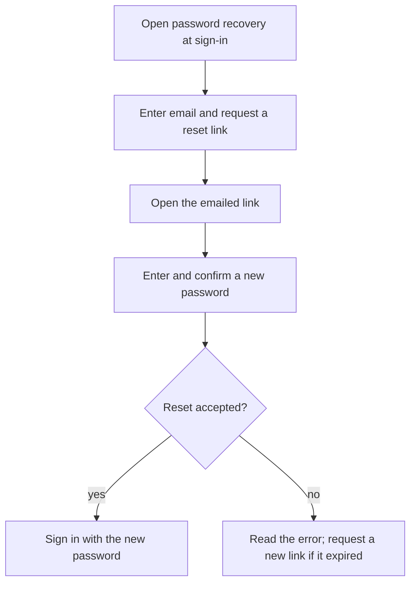
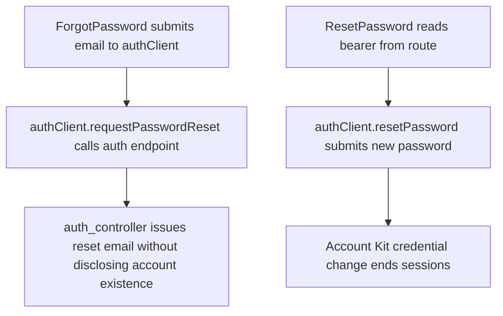

# US-SET-13 — Recover a password

As a person with an account, I want to reset a forgotten password so that I can regain sign-in access.

**Status:** Current — detailed account story is US-ACCOUNT-03.
**Access:** Any person with an account
**Entry:** Sign in → Forgot password?
**Documentation:** [Account](../../docs-src/using/account.md)
**Source:** [ForgotPassword.tsx](../../apps/frontend/src/auth/ForgotPassword.tsx), [ResetPassword.tsx](../../apps/frontend/src/auth/ResetPassword.tsx)

## Acceptance criteria

- Use the recovery email and new-password fields in [Recover a password](../account/US-ACCOUNT-03-password-reset.md).

## User flow

## Code flow

**Code references:** [ForgotPassword.tsx](../../apps/frontend/src/auth/ForgotPassword.tsx), [ResetPassword.tsx](../../apps/frontend/src/auth/ResetPassword.tsx), [authClient.ts](../../apps/frontend/src/auth/authClient.ts), [auth_controller.ts](../../apps/backend/app/controllers/auth_controller.ts)
