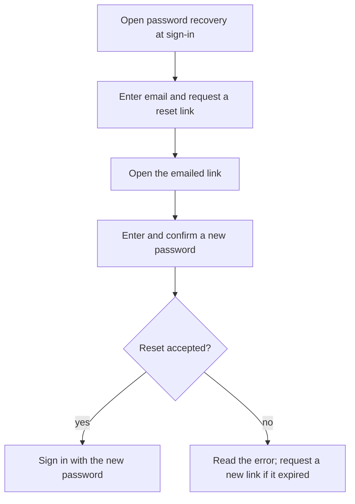
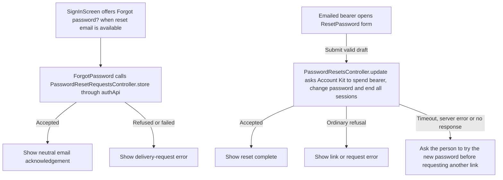

# US-SET-13 — Recover a password

As a person with an account, I want to reset a forgotten password so that I can regain sign-in access.

**Status:** Current — detailed account story is US-ACCOUNT-03.
**Access:** Any person with an account
**Entry:** Sign in → Forgot password?
**Documentation:** [Account](../../docs-src/using/account.md)
**Source:** [ForgotPassword.tsx](../../apps/frontend/src/auth/ForgotPassword.tsx), [ResetPassword.tsx](../../apps/frontend/src/auth/ResetPassword.tsx)

## Acceptance criteria

- Use the recovery email and new-password fields in [Recover a password](../account/US-ACCOUNT-03-password-reset.md).

## User flow

## Code flow

See [Recover a forgotten password](../account/US-ACCOUNT-03-password-reset.md#code-flow) for the separate inspection API and detailed reset outcomes.

**Code references:** [SignInScreen.tsx](../../apps/frontend/src/auth/SignInScreen.tsx#L83) · [ForgotPassword.tsx](../../apps/frontend/src/auth/ForgotPassword.tsx#L18) · [ResetPassword.tsx](../../apps/frontend/src/auth/ResetPassword.tsx#L164) · [password_reset_requests_controller.ts](../../apps/backend/app/controllers/password_reset_requests_controller.ts#L15) · [password_resets_controller.ts](../../apps/backend/app/controllers/password_resets_controller.ts#L22) · [recovery.spec.ts](../../apps/backend/tests/functional/auth/recovery.spec.ts#L77)
