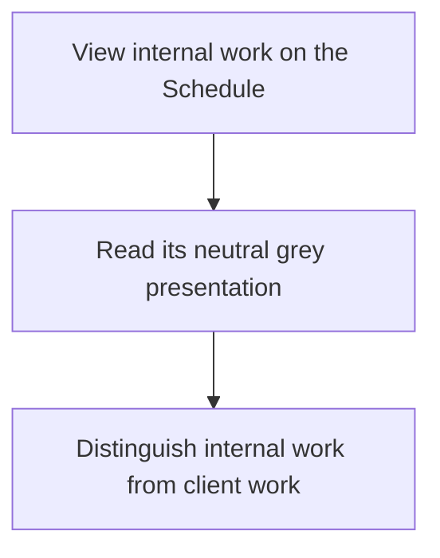
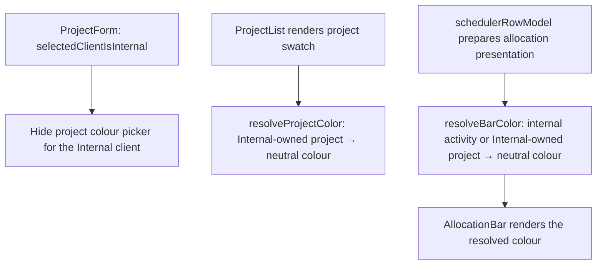

# US-SET-14 — Use neutral internal-work colours

As a company member, I want internal work to use neutral grey so that it stays distinct from client work.

**Status:** Current
**Access:** Owner, Admin, Editor, Viewer
**Entry:** Schedule and activity views
**Documentation:** [Schedule and change work](../../docs-src/using/schedule-work.md)
**Source:** [AllocationBar.tsx](../../apps/frontend/src/components/scheduler/AllocationBar.tsx), [ProjectForm.tsx](../../apps/frontend/src/components/projects/ProjectForm.tsx)

## Acceptance criteria

- Internal work uses neutral grey; no internal-work colour control is available.

## User flow

## Code flow

**Code references:** [ProjectForm.tsx](../../apps/frontend/src/components/projects/ProjectForm.tsx), [ProjectList.tsx](../../apps/frontend/src/components/projects/ProjectList.tsx), [color.ts](../../packages/shared/src/lib/color.ts), [schedulerRowModel.ts](../../apps/frontend/src/components/scheduler/schedulerRowModel.ts), [AllocationBar.tsx](../../apps/frontend/src/components/scheduler/AllocationBar.tsx)
