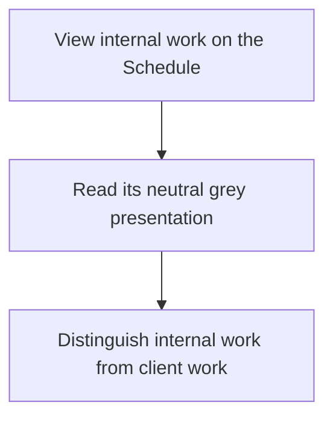
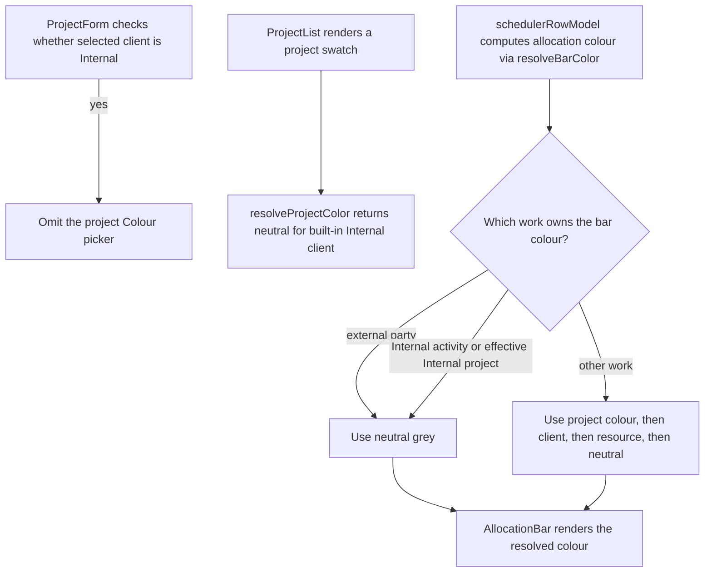

# US-SET-14 — Use neutral internal-work colours

As a company member, I want internal work to use neutral grey so that it stays distinct from client work.

**Status:** Current
**Access:** Owner, Admin, Editor, Viewer
**Entry:** Schedule and activity views
**Documentation:** [Schedule and change work](../../docs-src/using/schedule-work.md)
**Source:** [AllocationBar.tsx](../../apps/frontend/src/components/scheduler/AllocationBar.tsx), [ProjectForm.tsx](../../apps/frontend/src/components/projects/ProjectForm.tsx)

## Acceptance criteria

- Internal work uses neutral grey; no internal-work colour control is available.

## User flow

## Code flow

External-party work shares the neutral colour, so neutral bars alone cannot distinguish Internal work.

**Code references:** [ProjectForm.tsx:59](../../apps/frontend/src/components/projects/ProjectForm.tsx#L59) · [ProjectList.tsx:35](../../apps/frontend/src/components/projects/ProjectList.tsx#L35) · [color.ts:89](../../packages/shared/src/lib/color.ts#L89) · [color.ts:110](../../packages/shared/src/lib/color.ts#L110) · [schedulerRowModel.ts:99](../../apps/frontend/src/components/scheduler/schedulerRowModel.ts#L99)
