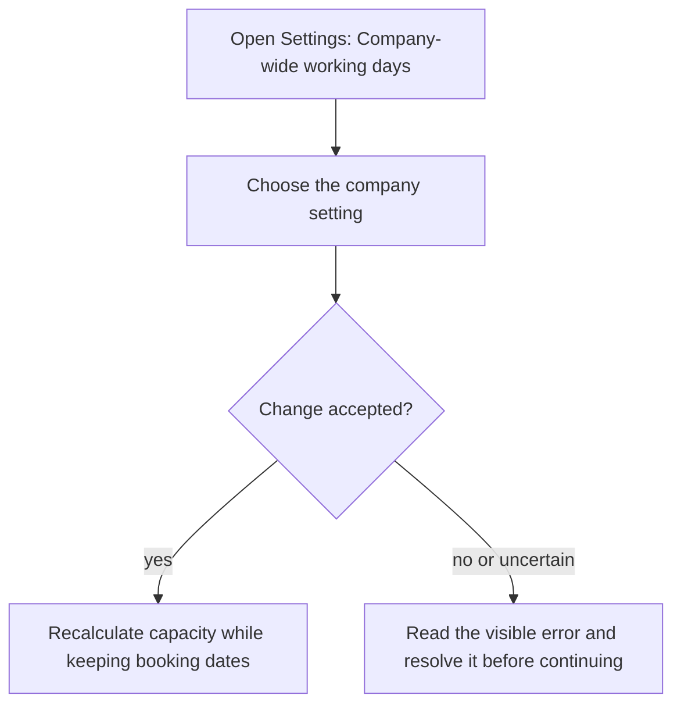
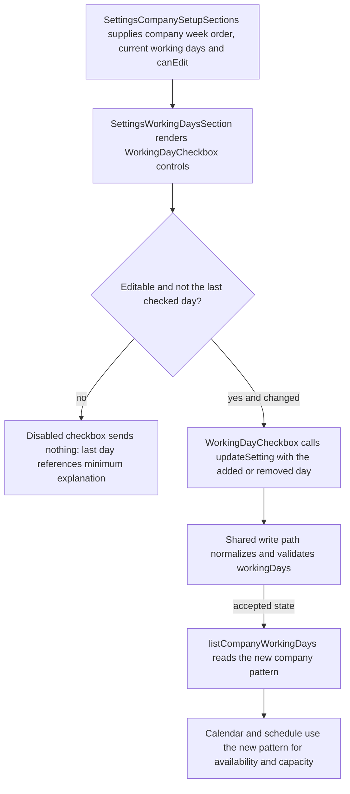

# US-SET-15 — Set company working days

As a company Editor, I want to set company working days so that capacity reflects our shared work week.

**Status:** Current
**Access:** Owner, Admin, Editor
**Entry:** Settings → Company setup → Company-wide working days
**Documentation:** [Settings](../../docs-src/using/settings.md)
**Source:** [SettingsWorkingDaysSection.tsx](../../apps/frontend/src/components/settings/SettingsWorkingDaysSection.tsx)

## Acceptance criteria

| Field         | Control            | Required/default/conditions                                        |
| ------------- | ------------------ | ------------------------------------------------------------------ |
| Monday–Sunday | Weekday checkboxes | Company-wide; at least one remains checked. Read-only for Viewers. |

- Changes apply immediately; existing booking dates remain in place.

## User flow

## Code flow

The [company setting write path](../REFERENCE.md#company-setting-writes) traces the common no-op, server commit, refusal and reconciliation branches.

**Code references:** [SettingsSchedulingSection.tsx:210](../../apps/frontend/src/components/settings/SettingsSchedulingSection.tsx#L210) · [SettingsWorkingDaysSection.tsx:26](../../apps/frontend/src/components/settings/SettingsWorkingDaysSection.tsx#L26) · [SettingsWorkingDaysSection.tsx:91](../../apps/frontend/src/components/settings/SettingsWorkingDaysSection.tsx#L91) · [typedPlanningActions.ts:331](../../apps/frontend/src/store/typedPlanningActions.ts#L331) · [selectors.ts:94](../../apps/frontend/src/store/selectors.ts#L94)
