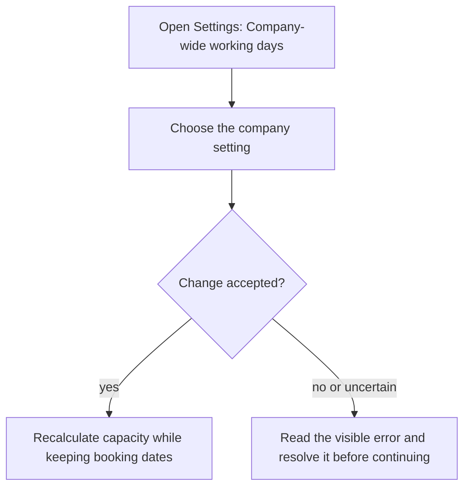
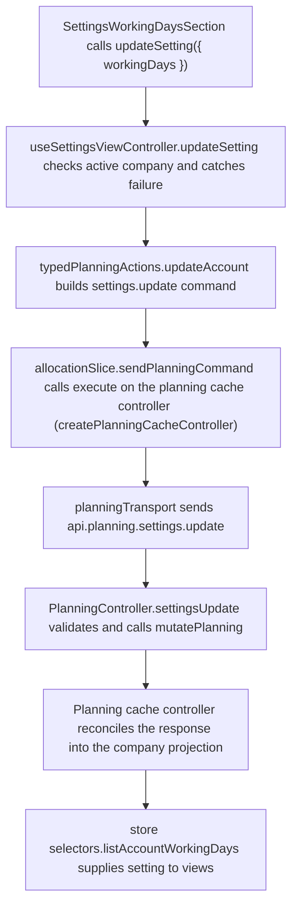

# US-SET-15 — Set company working days

As a company Editor, I want to set company working days so that capacity reflects our shared work week.

**Status:** Current
**Access:** Owner, Admin, Editor
**Entry:** Settings → Company setup → Company-wide working days
**Documentation:** [Settings](../../docs-src/using/settings.md)
**Source:** [SettingsWorkingDaysSection.tsx](../../apps/frontend/src/components/settings/SettingsWorkingDaysSection.tsx)

## Acceptance criteria

| Field         | Control            | Required/default/conditions                                        |
| ------------- | ------------------ | ------------------------------------------------------------------ |
| Monday–Sunday | Weekday checkboxes | Company-wide; at least one remains checked. Read-only for Viewers. |

- Changes apply immediately; existing booking dates remain in place.

## User flow

## Code flow

**Code references:** [SettingsWorkingDaysSection.tsx](../../apps/frontend/src/components/settings/SettingsWorkingDaysSection.tsx), [useSettingsViewController.ts](../../apps/frontend/src/components/settings/useSettingsViewController.ts), [typedPlanningActions.ts](../../apps/frontend/src/store/typedPlanningActions.ts), [allocationSlice.ts](../../apps/frontend/src/store/slices/allocationSlice.ts), [planningCacheController.ts](../../apps/frontend/src/data/planning/planningCacheController.ts), [planningTransport.ts](../../apps/frontend/src/data/planning/planningTransport.ts), [planning_routes.ts](../../apps/backend/start/planning_routes.ts), [planning_controller.ts](../../apps/backend/app/controllers/planning_controller.ts), [planning.ts](../../apps/backend/app/services/planning.ts), [selectors.ts](../../apps/frontend/src/store/selectors.ts)
