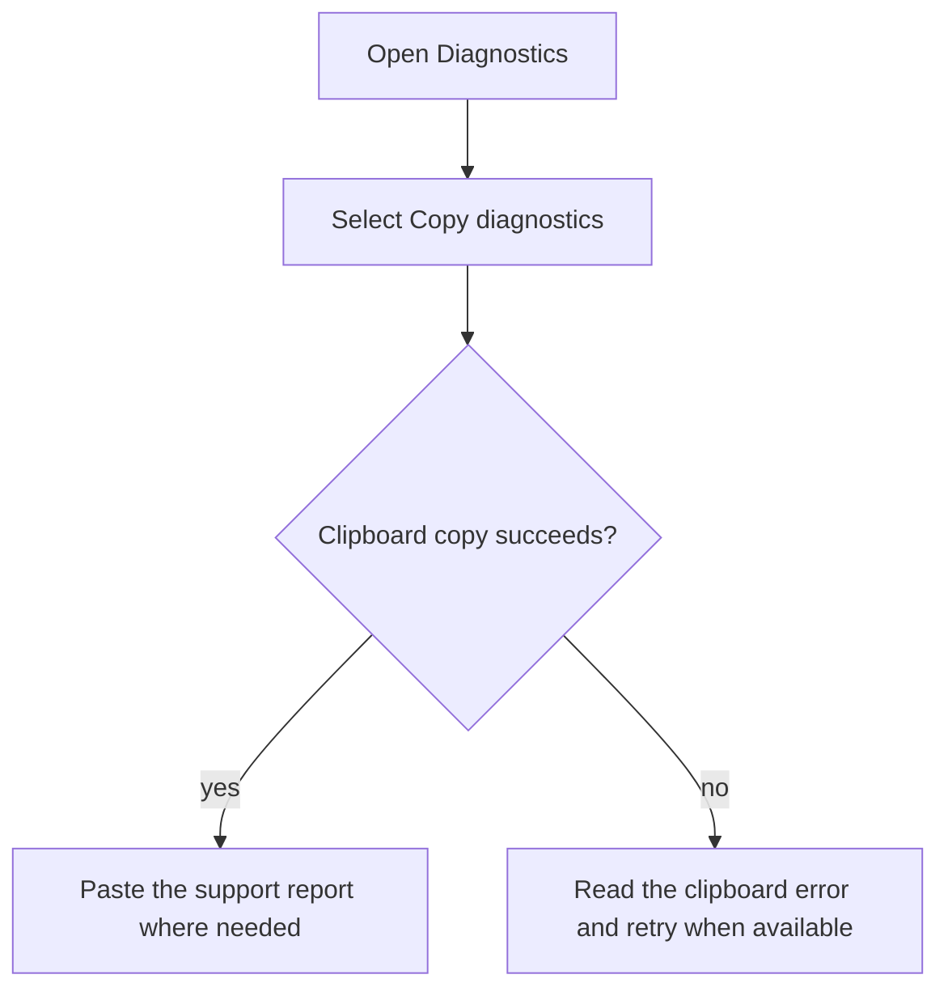
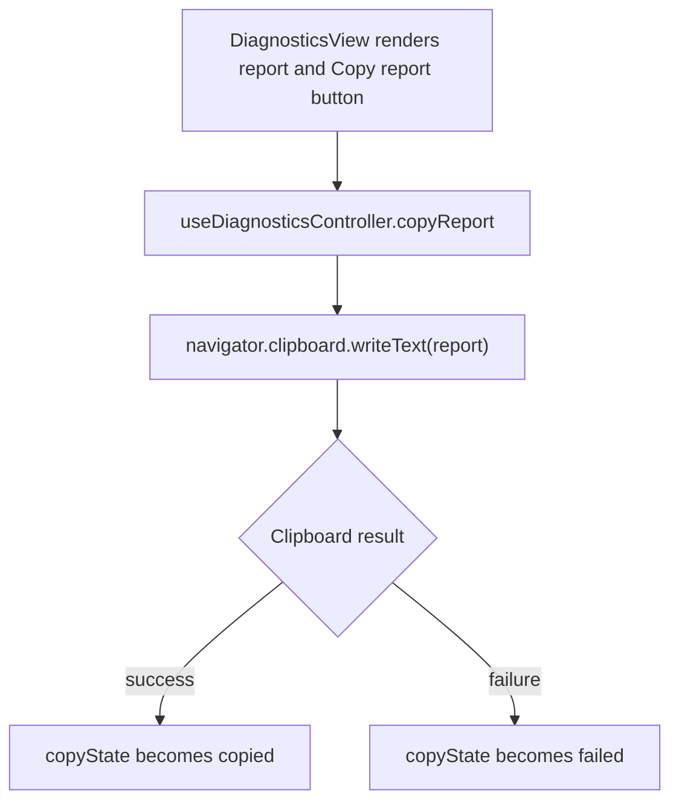

# US-SET-16 — Copy diagnostics

As an Owner or Admin, I want to copy diagnostics so that I can share useful troubleshooting details.

**Status:** Current
**Access:** Owner, Admin
**Entry:** Diagnostics → Copy diagnostics
**Documentation:** [Diagnostics](../../docs-src/admin/diagnostics.md)
**Source:** [DiagnosticsView.tsx](../../apps/frontend/src/components/diagnostics/DiagnosticsView.tsx)

## Acceptance criteria

- **Copy diagnostics** copies the displayed support report and shows confirmation or a clipboard error.

## User flow

## Code flow

**Code references:** [DiagnosticsView.tsx](../../apps/frontend/src/components/diagnostics/DiagnosticsView.tsx), [useDiagnosticsController.ts](../../apps/frontend/src/components/diagnostics/useDiagnosticsController.ts), [buildInfo.ts](../../apps/frontend/src/data/buildInfo.ts)
