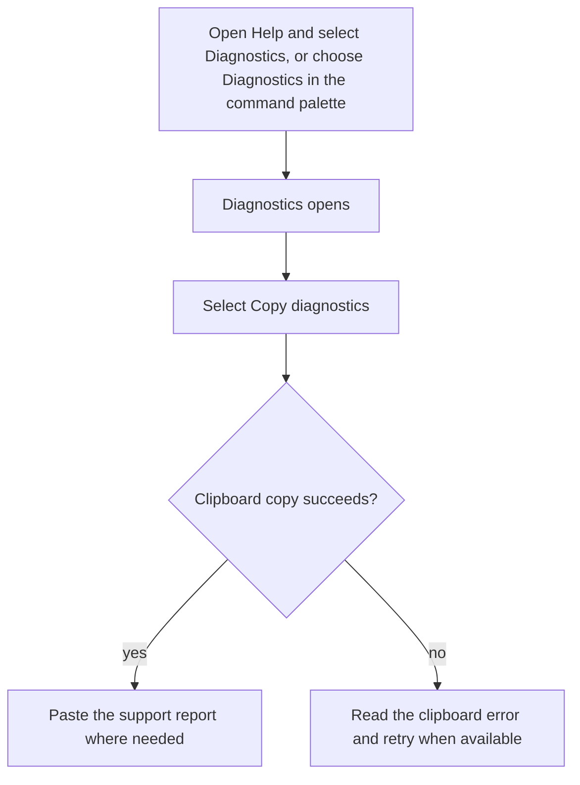
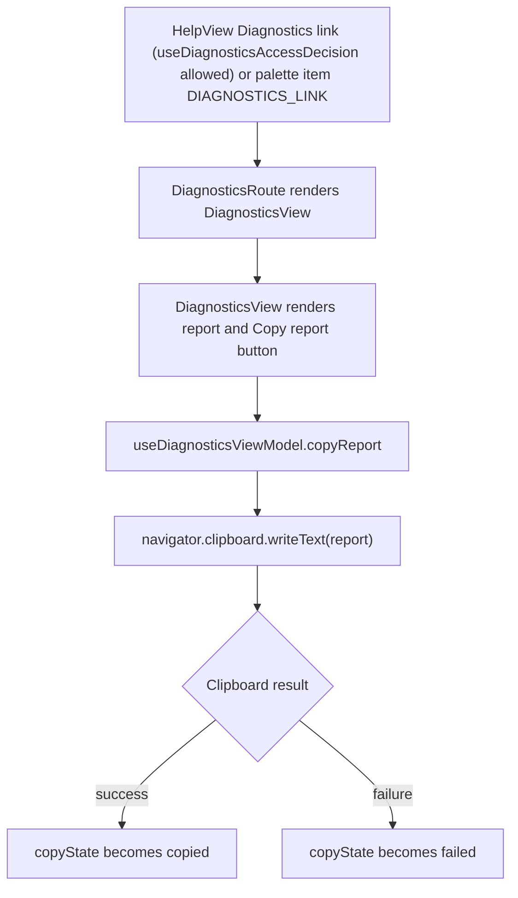

# US-SET-16 — Copy diagnostics

As an Owner or Admin, I want to copy diagnostics so that I can share useful troubleshooting details.

**Status:** Current
**Access:** Owner, Admin
**Entry:** Help → Diagnostics (Owner, Admin) or the command palette → Diagnostics, then Copy diagnostics
**Documentation:** [Diagnostics](../../docs-src/admin/diagnostics.md)
**Source:** [DiagnosticsView.tsx](../../apps/frontend/src/components/diagnostics/DiagnosticsView.tsx)

## Acceptance criteria

- Diagnostics is not in the left menu. Owners and Admins open it from the **Diagnostics** link on Help or from the command palette; Editors and Viewers see neither, and `/diagnostics` redirects them to the schedule.
- **Copy diagnostics** copies the displayed support report and shows confirmation or a clipboard error.

## User flow

## Code flow

**Code references:** [HelpView.tsx](../../apps/frontend/src/components/HelpView.tsx), [navLinks.ts](../../apps/frontend/src/lib/navLinks.ts), [buildPaletteItems.ts](../../apps/frontend/src/components/buildPaletteItems.ts), [router.tsx](../../apps/frontend/src/router.tsx), [useDiagnosticsAccessDecision.ts](../../apps/frontend/src/components/diagnostics/useDiagnosticsAccessDecision.ts), [DiagnosticsView.tsx](../../apps/frontend/src/components/diagnostics/DiagnosticsView.tsx), [useDiagnosticsViewModel.ts](../../apps/frontend/src/components/diagnostics/useDiagnosticsViewModel.ts), [buildInfo.ts](../../apps/frontend/src/data/buildInfo.ts)
