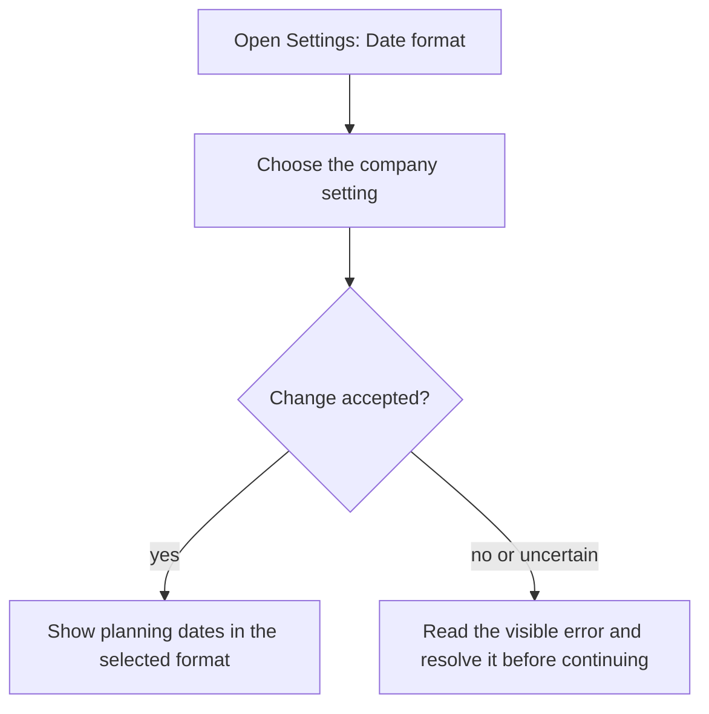
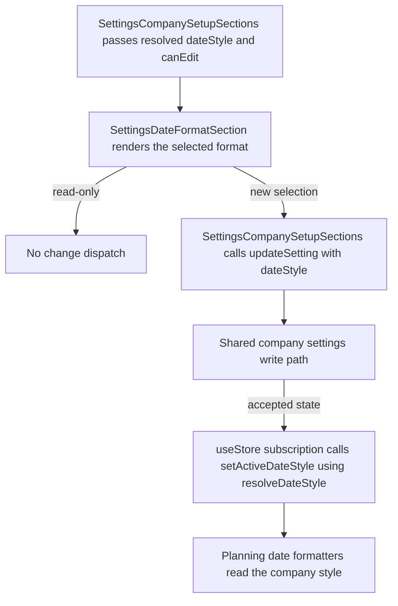

# US-SET-17 — Choose the date format

As a company Editor, I want to choose the date format so that planning dates are readable consistently by the team.

**Status:** Current
**Access:** Owner, Admin, Editor
**Entry:** Settings → Company setup → Date format
**Documentation:** [Settings](../../docs-src/using/settings.md)
**Source:** [SettingsDateFormatSection.tsx](../../apps/frontend/src/components/settings/SettingsDateFormatSection.tsx)

## Acceptance criteria

| Field       | Control           | Required/default/conditions                                            |
| ----------- | ----------------- | ---------------------------------------------------------------------- |
| Date format | Segmented control | Company-wide; 9 Sep, 9th Sep, Sep 9 or Sep 9th. Read-only for Viewers. |

## User flow

## Code flow

The [company setting write path](../REFERENCE.md#company-setting-writes) traces the common no-op, server commit, refusal and reconciliation branches.

**Code references:** [SettingsDateFormatSection.tsx:10](../../apps/frontend/src/components/settings/SettingsDateFormatSection.tsx#L10) · [SettingsSchedulingSection.tsx:225](../../apps/frontend/src/components/settings/SettingsSchedulingSection.tsx#L225) · [selectors.ts:29](../../apps/frontend/src/store/selectors.ts#L29) · [useStore.ts:57](../../apps/frontend/src/store/useStore.ts#L57)
