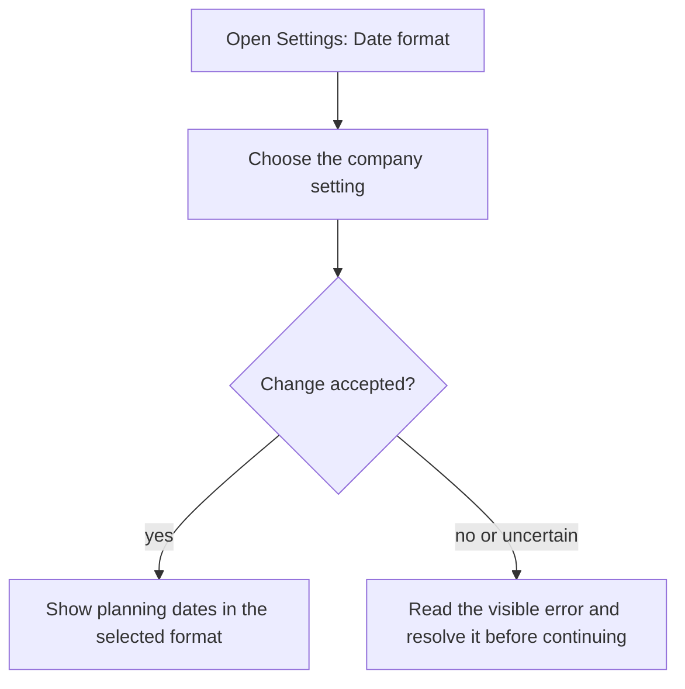
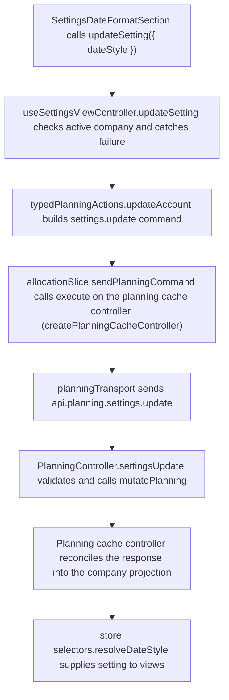

# US-SET-17 — Choose the date format

As a company Editor, I want to choose the date format so that planning dates are readable consistently by the team.

**Status:** Current
**Access:** Owner, Admin, Editor
**Entry:** Settings → Company setup → Date format
**Documentation:** [Settings](../../docs-src/using/settings.md)
**Source:** [SettingsDateFormatSection.tsx](../../apps/frontend/src/components/settings/SettingsDateFormatSection.tsx)

## Acceptance criteria

| Field       | Control           | Required/default/conditions                                            |
| ----------- | ----------------- | ---------------------------------------------------------------------- |
| Date format | Segmented control | Company-wide; 9 Sep, 9th Sep, Sep 9 or Sep 9th. Read-only for Viewers. |

## User flow

## Code flow

**Code references:** [SettingsDateFormatSection.tsx](../../apps/frontend/src/components/settings/SettingsDateFormatSection.tsx), [useSettingsViewController.ts](../../apps/frontend/src/components/settings/useSettingsViewController.ts), [typedPlanningActions.ts](../../apps/frontend/src/store/typedPlanningActions.ts), [allocationSlice.ts](../../apps/frontend/src/store/slices/allocationSlice.ts), [planningCacheController.ts](../../apps/frontend/src/data/planning/planningCacheController.ts), [planningTransport.ts](../../apps/frontend/src/data/planning/planningTransport.ts), [planning_routes.ts](../../apps/backend/start/planning_routes.ts), [planning_controller.ts](../../apps/backend/app/controllers/planning_controller.ts), [planning.ts](../../apps/backend/app/services/planning.ts), [selectors.ts](../../apps/frontend/src/store/selectors.ts)
