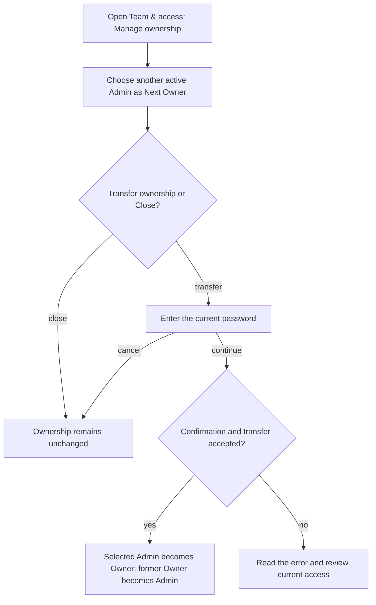
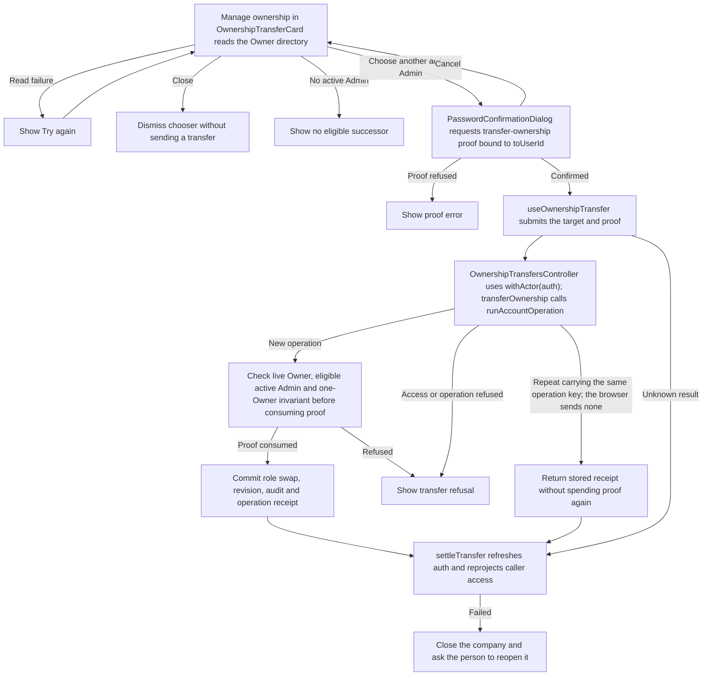

# US-SET-18 — Transfer company ownership

As an Owner, I want to transfer company ownership so that another active Admin can take responsibility.

**Status:** Current
**Access:** Owner
**Entry:** Team & access → Company ownership
**Documentation:** [Transfer ownership](../../docs-src/owner/responsibilities.md#transfer-ownership)
**Source:** [OwnershipTransferCard.tsx](../../apps/frontend/src/components/team/OwnershipTransferCard.tsx), [PasswordConfirmationDialog.tsx](../../apps/frontend/src/auth/PasswordConfirmationDialog.tsx)

## Acceptance criteria

| Field      | Control        | Required/default/conditions                                                  |
| ---------- | -------------- | ---------------------------------------------------------------------------- |
| Next Owner | Member picker  | Required to transfer; another active Admin in this company.                  |
| Password   | Password input | Required in the following confirmation dialog; the current Owner's password. |

- **Transfer ownership** opens password confirmation; **Continue** completes it. **Close** or **Cancel** leaves ownership unchanged. The selected Admin becomes Owner and the former Owner becomes Admin.

## User flow

## Code flow

See [password proof issuance](../data/US-DAT-08-preview-exact-import.md#code-flow) for the shared authorization callback. Ownership transfer binds the proof to the selected successor.

**Code references:** [OwnershipTransferCard.tsx](../../apps/frontend/src/components/team/OwnershipTransferCard.tsx#L69) · [OwnershipTransferCard.tsx](../../apps/frontend/src/components/team/OwnershipTransferCard.tsx#L114) · [useOwnershipTransfer.ts](../../apps/frontend/src/components/team/useOwnershipTransfer.ts#L32) · [useOwnershipTransfer.ts](../../apps/frontend/src/components/team/useOwnershipTransfer.ts#L115) · [ownership_transfers_controller.ts](../../apps/backend/app/controllers/ownership_transfers_controller.ts#L25) · [ownership_transfer_service.ts](../../apps/backend/app/services/membership/ownership_transfer_service.ts#L54) · [account_operation_service.ts](../../apps/backend/app/services/account_operation_service.ts#L33) · [ownership_transfer.spec.ts](../../apps/backend/tests/functional/membership/ownership_transfer.spec.ts#L127)
