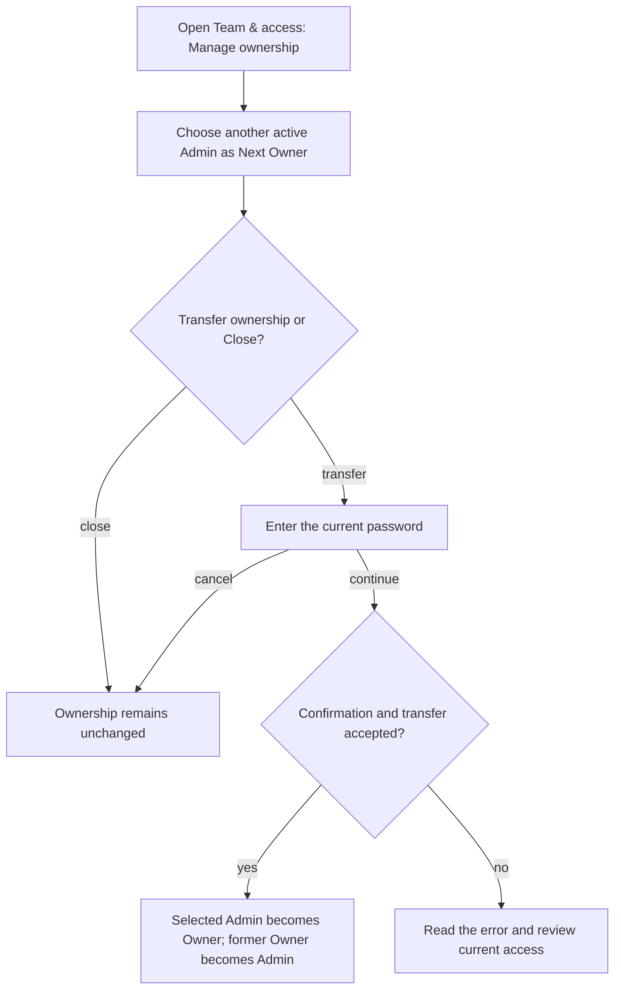
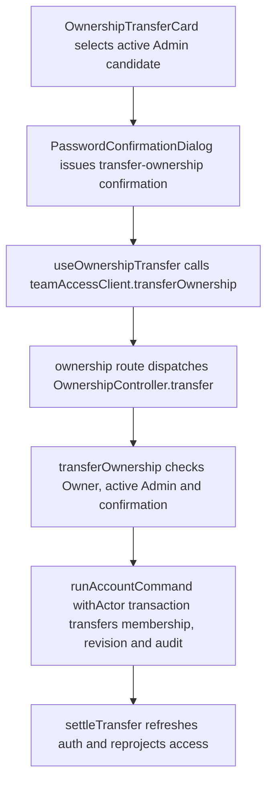

# US-SET-18 — Transfer company ownership

As an Owner, I want to transfer company ownership so that another active Admin can take responsibility.

**Status:** Current
**Access:** Owner
**Entry:** Team & access → Company ownership
**Documentation:** [Transfer ownership](../../docs-src/owner/responsibilities.md#transfer-ownership)
**Source:** [OwnershipTransferCard.tsx](../../apps/frontend/src/components/team/OwnershipTransferCard.tsx), [PasswordConfirmationDialog.tsx](../../apps/frontend/src/auth/PasswordConfirmationDialog.tsx)

## Acceptance criteria

| Field      | Control        | Required/default/conditions                                                  |
| ---------- | -------------- | ---------------------------------------------------------------------------- |
| Next Owner | Member picker  | Required to transfer; another active Admin in this company.                  |
| Password   | Password input | Required in the following confirmation dialog; the current Owner's password. |

- **Transfer ownership** opens password confirmation; **Continue** completes it. **Close** or **Cancel** leaves ownership unchanged. The selected Admin becomes Owner and the former Owner becomes Admin.

## User flow

## Code flow

**Code references:** [OwnershipTransferCard.tsx](../../apps/frontend/src/components/team/OwnershipTransferCard.tsx), [useOwnershipTransfer.ts](../../apps/frontend/src/components/team/useOwnershipTransfer.ts), [teamAccessClient.ts](../../apps/frontend/src/account/teamAccessClient.ts), [PasswordConfirmationDialog.tsx](../../apps/frontend/src/auth/PasswordConfirmationDialog.tsx), [ownership_routes.ts](../../apps/backend/start/ownership_routes.ts), [ownership_controller.ts](../../apps/backend/app/controllers/ownership_controller.ts), [ownership_transfer.ts](../../apps/backend/app/services/membership/ownership_transfer.ts), [account_commands.ts](../../apps/backend/app/services/account_commands.ts)
