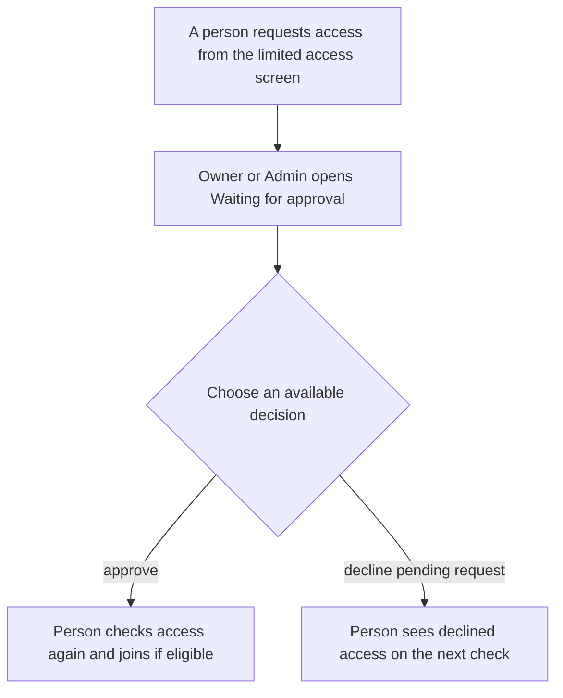
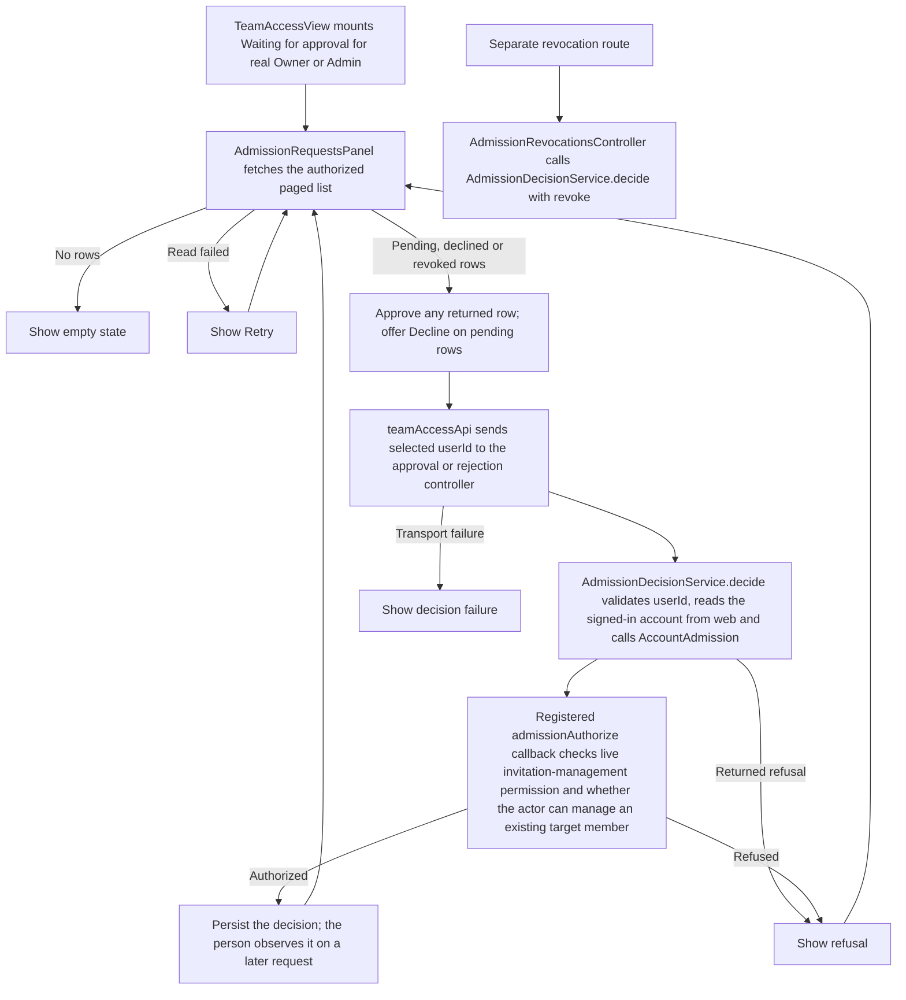

# US-SET-19 — Approve company admission

As an Owner or Admin, I want to approve or decline admission so that company access follows our admission rules.

**Status:** Current
**Access:** Owner, Admin; invited person
**Entry:** Team & access → Waiting for approval; admission screen
**Documentation:** [Invite teammates](../../docs-src/admin/invite-teammates.md)
**Source:** [AdmissionRequestsPanel.tsx](../../apps/frontend/src/components/team/AdmissionRequestsPanel.tsx)

## Acceptance criteria

- Invitation acceptance creates membership but does not grant company data before approval. Owner/Admin decisions apply on the person’s next request. See [US-TEAM-05](../team/US-TEAM-05-request-admission.md).

## User flow

## Code flow

See [Request company access and check the decision](../team/US-TEAM-05-request-admission.md#code-flow) for the person’s next session check.

**Code references:** [TeamAccessView.tsx](../../apps/frontend/src/components/team/TeamAccessView.tsx#L196) · [AdmissionRequestsPanel.tsx](../../apps/frontend/src/components/team/AdmissionRequestsPanel.tsx#L51) · [AdmissionRequestsPanel.tsx](../../apps/frontend/src/components/team/AdmissionRequestsPanel.tsx#L75) · [teamAccessApi.ts](../../apps/frontend/src/account/teamAccessApi.ts#L126) · [admission_decision_service.ts](../../apps/backend/app/services/admission/admission_decision_service.ts#L21) · [package_callbacks_provider.ts](../../apps/backend/providers/package_callbacks_provider.ts#L51) · [admission_rule_service.ts](../../apps/backend/app/services/account_kit/admission_rule_service.ts#L60) · [admission_approvals_controller.ts](../../apps/backend/app/controllers/admission_approvals_controller.ts#L18) · [admission.ts](../../apps/backend/start/routes/admission.ts#L40) · [admission.spec.ts](../../apps/backend/tests/functional/auth/admission.spec.ts#L167)
