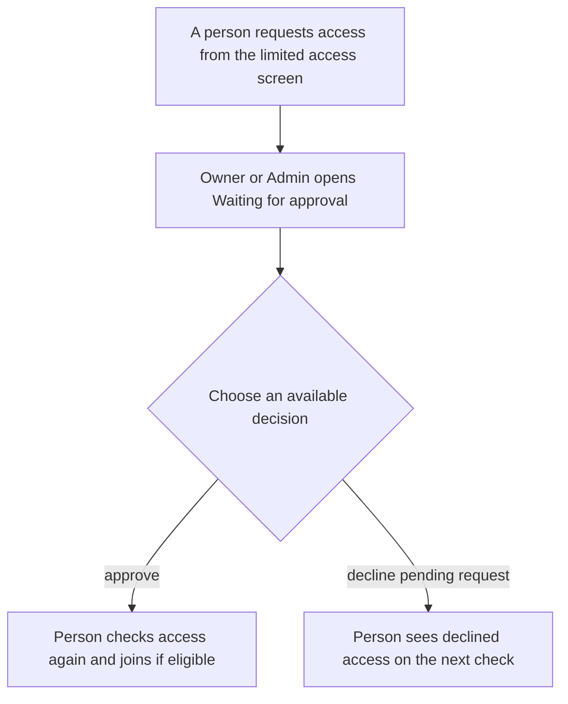
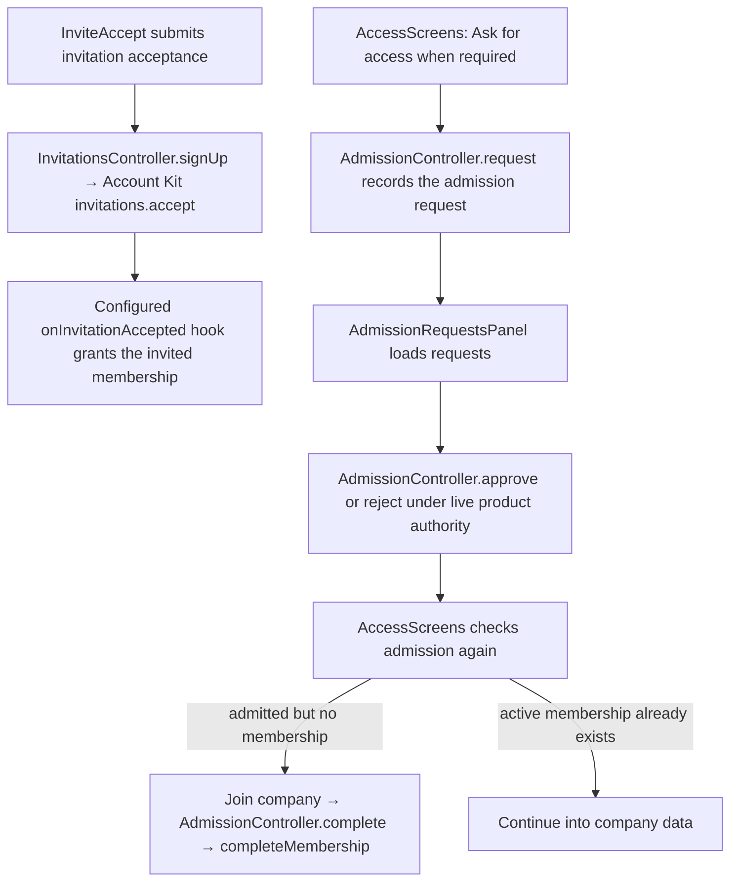

# US-SET-19 — Approve company admission

As an Owner or Admin, I want to approve or decline admission so that company access follows our admission policy.

**Status:** Current
**Access:** Owner, Admin; invited person
**Entry:** Team & access → Waiting for approval; admission screen
**Documentation:** [Invite teammates](../../docs-src/admin/invite-teammates.md)
**Source:** [AdmissionRequestsPanel.tsx](../../apps/frontend/src/components/team/AdmissionRequestsPanel.tsx)

## Acceptance criteria

- Invitation acceptance creates membership but does not grant company data before approval. Owner/Admin decisions apply on the person’s next request. See [US-TEAM-05](../team/US-TEAM-05-request-admission.md).

## User flow

## Code flow

**Code references:** [InviteAccept.tsx](../../apps/frontend/src/components/invites/InviteAccept.tsx), [AccessScreens.tsx](../../apps/frontend/src/auth/AccessScreens.tsx), [AdmissionRequestsPanel.tsx](../../apps/frontend/src/components/team/AdmissionRequestsPanel.tsx), [invitations_controller.ts](../../apps/backend/app/controllers/invitations_controller.ts), [account_kit.ts](../../apps/backend/config/account_kit.ts), [policy.ts](../../apps/backend/app/services/account_kit/policy.ts), [admission_controller.ts](../../apps/backend/app/controllers/admission_controller.ts), [admission_membership.ts](../../apps/backend/app/services/membership/admission_membership.ts)
