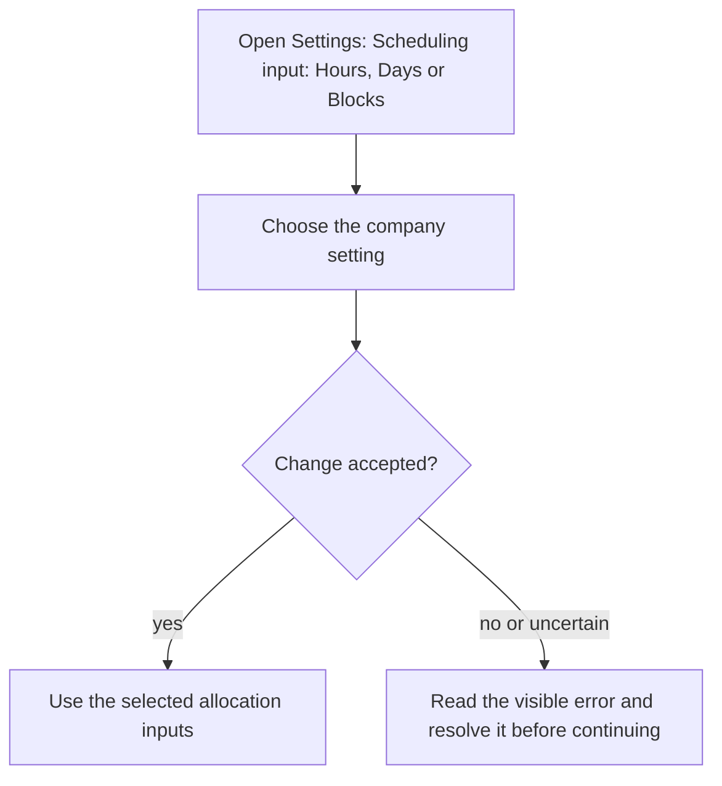
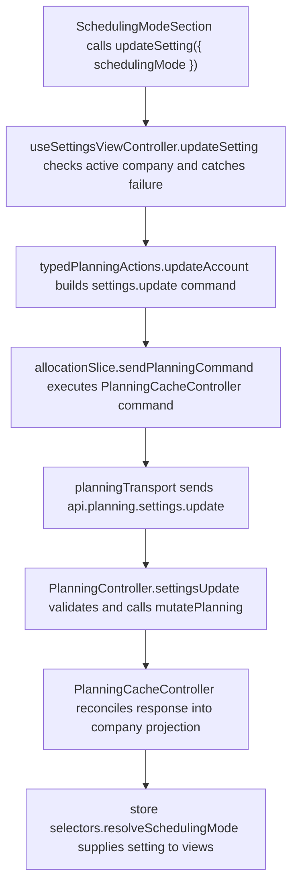

# US-SET-20 — Choose scheduling units

As a company Editor, I want to choose scheduling units so that bookings use the company’s preferred measure.

**Status:** Current
**Access:** Owner, Admin, Editor
**Entry:** Settings → Company setup → Allocation units
**Documentation:** [Settings](../../docs-src/using/settings.md)
**Source:** [SettingsSchedulingSection.tsx](../../apps/frontend/src/components/settings/SettingsSchedulingSection.tsx)

## Acceptance criteria

| Field            | Control           | Required/default/conditions                                 |
| ---------------- | ----------------- | ----------------------------------------------------------- |
| Scheduling input | Segmented control | Hours, Days or Blocks; company-wide, read-only for Viewers. |

## User flow

## Code flow

The persisted server path is shown; the temporary demo applies these planning commands in memory.

**Code references:** [SettingsSchedulingSection.tsx](../../apps/frontend/src/components/settings/SettingsSchedulingSection.tsx), [useSettingsViewController.ts](../../apps/frontend/src/components/settings/useSettingsViewController.ts), [typedPlanningActions.ts](../../apps/frontend/src/store/typedPlanningActions.ts), [allocationSlice.ts](../../apps/frontend/src/store/slices/allocationSlice.ts), [planningCacheController.ts](../../apps/frontend/src/data/planning/planningCacheController.ts), [planningTransport.ts](../../apps/frontend/src/data/planning/planningTransport.ts), [planning_routes.ts](../../apps/backend/start/planning_routes.ts), [planning_controller.ts](../../apps/backend/app/controllers/planning_controller.ts), [planning.ts](../../apps/backend/app/services/planning.ts), [selectors.ts](../../apps/frontend/src/store/selectors.ts)
