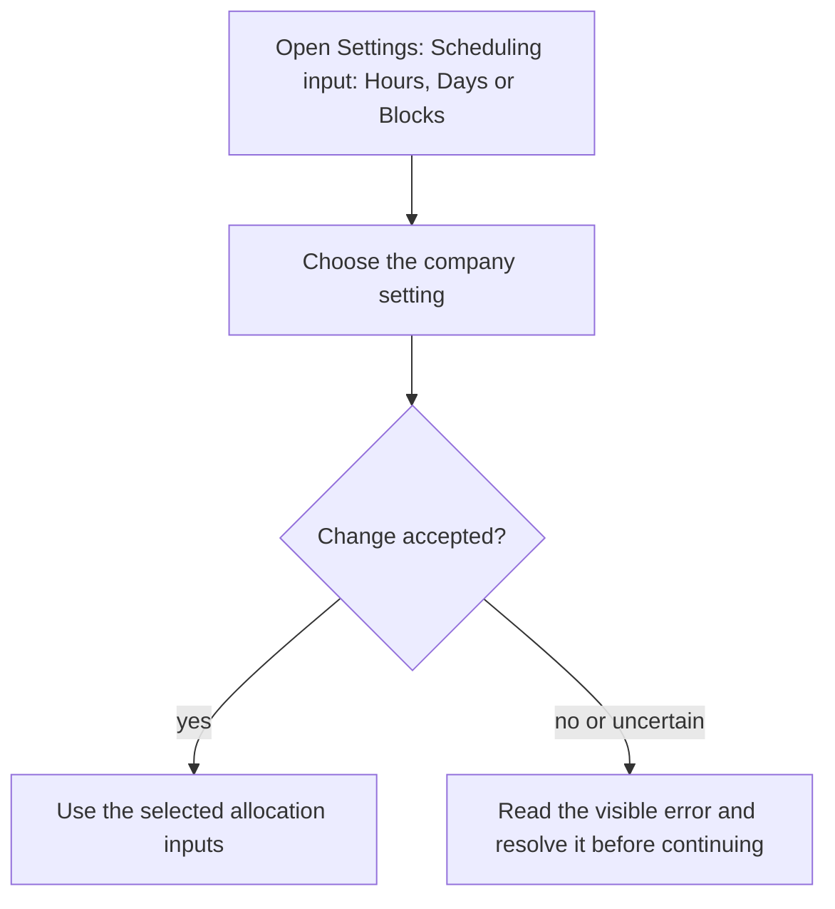
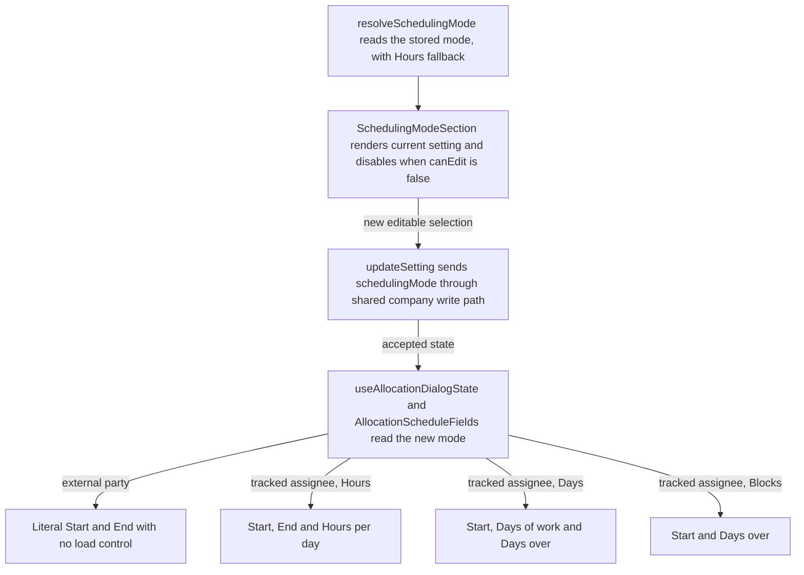

# US-SET-20 — Choose scheduling units

As a company Editor, I want to choose scheduling units so that bookings use the company’s preferred measure.

**Status:** Current
**Access:** Owner, Admin, Editor
**Entry:** Settings → Company setup → Allocation units
**Documentation:** [Settings](../../docs-src/using/settings.md)
**Source:** [SettingsSchedulingSection.tsx](../../apps/frontend/src/components/settings/SettingsSchedulingSection.tsx)

## Acceptance criteria

| Field            | Control           | Required/default/conditions                                 |
| ---------------- | ----------------- | ----------------------------------------------------------- |
| Scheduling input | Segmented control | Hours, Days or Blocks; company-wide, read-only for Viewers. |

## User flow

## Code flow

The [company setting write path](../REFERENCE.md#company-setting-writes) traces the common no-op, server commit, refusal and reconciliation branches.

**Code references:** [selectors.ts:36](../../apps/frontend/src/store/selectors.ts#L36) · [SettingsSchedulingSection.tsx:65](../../apps/frontend/src/components/settings/SettingsSchedulingSection.tsx#L65) · [initial_company_defaults.ts:30](../../apps/backend/app/services/initial_company_defaults.ts#L30) · [useAllocationDialogState.ts:42](../../apps/frontend/src/components/scheduler/useAllocationDialogState.ts#L42) · [AllocationScheduleFields.tsx:123](../../apps/frontend/src/components/scheduler/AllocationScheduleFields.tsx#L123) · [AllocationScheduleFields.tsx:281](../../apps/frontend/src/components/scheduler/AllocationScheduleFields.tsx#L281)
