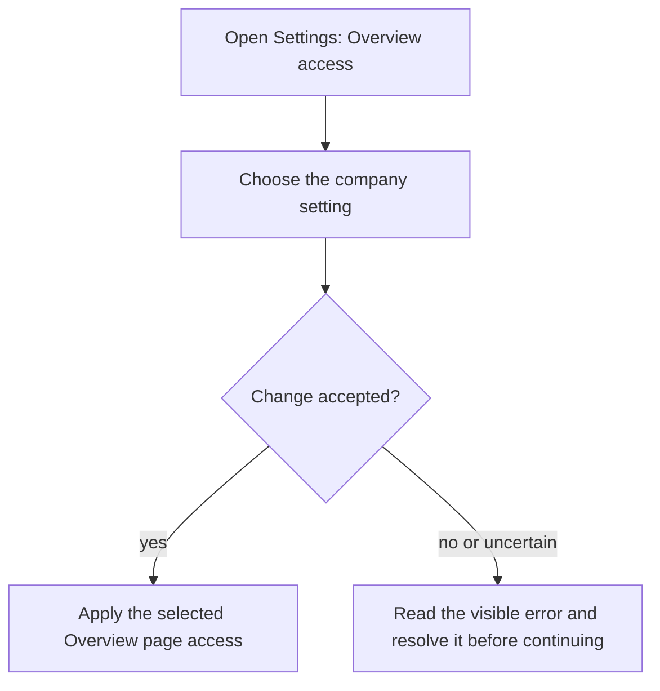
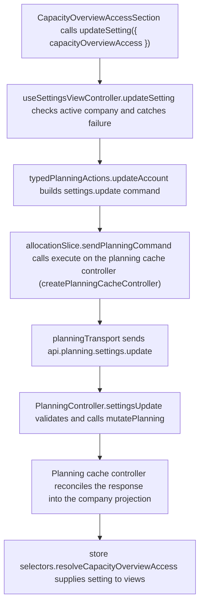

# US-SET-21 — Control Overview access

As an Owner or Admin, I want to control Overview access so that the page is available to the intended roles.

**Status:** Current
**Access:** Owner, Admin can change; all roles see configured access
**Entry:** Settings → Company setup → Overview access
**Documentation:** [Settings](../../docs-src/using/settings.md)
**Source:** [SettingsSchedulingSection.tsx](../../apps/frontend/src/components/settings/SettingsSchedulingSection.tsx)

## Acceptance criteria

| Field           | Control           | Required/default/conditions                                                             |
| --------------- | ----------------- | --------------------------------------------------------------------------------------- |
| Overview access | Segmented control | Admins, Admins & Editors, Everyone. Defaults to Admins; only Owner/Admin can change it. |

## User flow

## Code flow

The persisted server path is shown; the temporary demo applies these planning commands in memory.

**Code references:** [SettingsSchedulingSection.tsx](../../apps/frontend/src/components/settings/SettingsSchedulingSection.tsx), [useSettingsViewController.ts](../../apps/frontend/src/components/settings/useSettingsViewController.ts), [typedPlanningActions.ts](../../apps/frontend/src/store/typedPlanningActions.ts), [allocationSlice.ts](../../apps/frontend/src/store/slices/allocationSlice.ts), [planningCacheController.ts](../../apps/frontend/src/data/planning/planningCacheController.ts), [planningTransport.ts](../../apps/frontend/src/data/planning/planningTransport.ts), [planning_routes.ts](../../apps/backend/start/planning_routes.ts), [planning_controller.ts](../../apps/backend/app/controllers/planning_controller.ts), [planning.ts](../../apps/backend/app/services/planning.ts), [selectors.ts](../../apps/frontend/src/store/selectors.ts)
