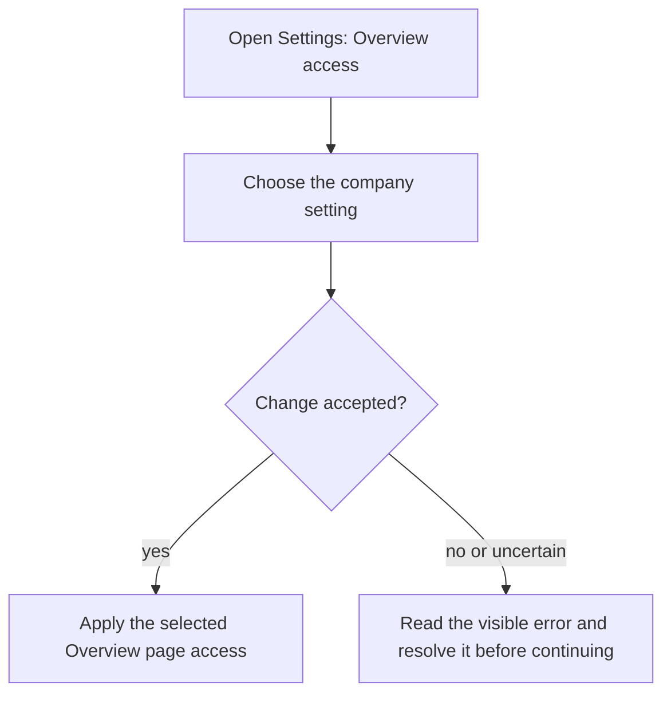
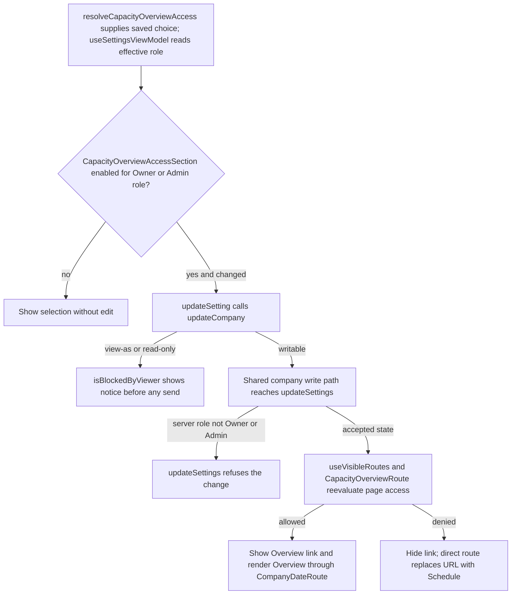

# US-SET-21 — Control Overview access

As an Owner or Admin, I want to control Overview access so that the page is available to the intended roles.

**Status:** Current
**Access:** Owner, Admin can change; all roles see configured access
**Entry:** Settings → Company setup → Overview access
**Documentation:** [Settings](../../docs-src/using/settings.md)
**Source:** [SettingsSchedulingSection.tsx](../../apps/frontend/src/components/settings/SettingsSchedulingSection.tsx)

## Acceptance criteria

| Field           | Control           | Required/default/conditions                                                             |
| --------------- | ----------------- | --------------------------------------------------------------------------------------- |
| Overview access | Segmented control | Admins, Admins & Editors, Everyone. Defaults to Admins; only Owner/Admin can change it. |

## User flow

## Code flow

The [company setting write path](../REFERENCE.md#company-setting-writes) traces the common no-op, server commit, refusal and reconciliation branches. The setting affects entry to the page. During a view-as Admin projection the control can look enabled while the store refuses the action.

**Code references:** [useSettingsViewModel.ts:55](../../apps/frontend/src/components/settings/useSettingsViewModel.ts#L55) · [SettingsSchedulingSection.tsx:36](../../apps/frontend/src/components/settings/SettingsSchedulingSection.tsx#L36) · [PermissionProvider.tsx:93](../../apps/frontend/src/auth/PermissionProvider.tsx#L93) · [storeRules.ts:27](../../apps/frontend/src/store/storeRules.ts#L27) · [writer.ts:88](../../apps/backend/app/services/planning/planning_writer_service.ts#L55) · [useVisibleRoutes.ts:37](../../apps/frontend/src/components/useVisibleRoutes.ts#L37) · [router.tsx:120](../../apps/frontend/src/router.tsx#L120)
