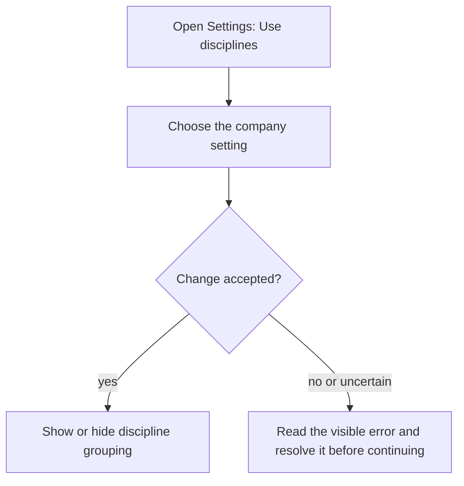
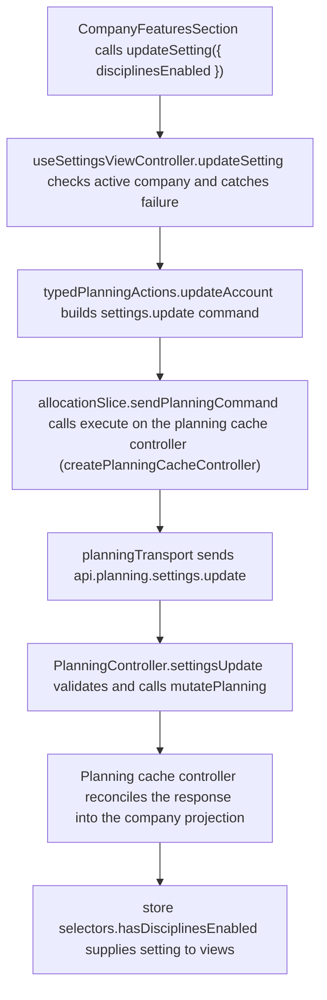

# US-SET-22 — Enable disciplines

As a company Editor, I want to enable disciplines so that people can be grouped by their work area.

**Status:** Current
**Access:** Owner, Admin, Editor
**Entry:** Settings → Scheduling features → Use disciplines
**Documentation:** [Settings](../../docs-src/using/settings.md)
**Source:** [SettingsSchedulingSection.tsx](../../apps/frontend/src/components/settings/SettingsSchedulingSection.tsx)

## Acceptance criteria

| Field           | Control | Required/default/conditions                                                          |
| --------------- | ------- | ------------------------------------------------------------------------------------ |
| Use disciplines | Switch  | Company-wide; Off in a new company; on in the sample demo. Hiding preserves records. |

## User flow

## Code flow

**Code references:** [SettingsSchedulingSection.tsx](../../apps/frontend/src/components/settings/SettingsSchedulingSection.tsx), [useSettingsViewController.ts](../../apps/frontend/src/components/settings/useSettingsViewController.ts), [typedPlanningActions.ts](../../apps/frontend/src/store/typedPlanningActions.ts), [allocationSlice.ts](../../apps/frontend/src/store/slices/allocationSlice.ts), [planningCacheController.ts](../../apps/frontend/src/data/planning/planningCacheController.ts), [planningTransport.ts](../../apps/frontend/src/data/planning/planningTransport.ts), [planning_routes.ts](../../apps/backend/start/planning_routes.ts), [planning_controller.ts](../../apps/backend/app/controllers/planning_controller.ts), [planning.ts](../../apps/backend/app/services/planning.ts), [selectors.ts](../../apps/frontend/src/store/selectors.ts)
