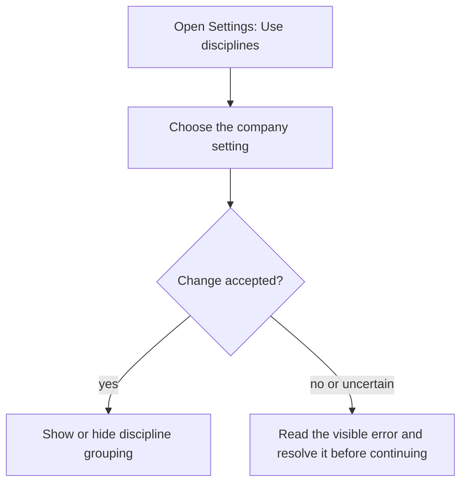
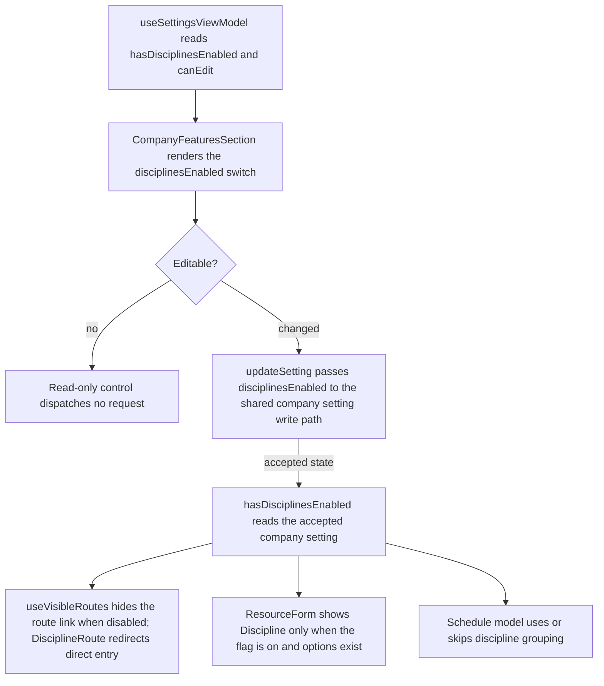

# US-SET-22 — Enable disciplines

As a company Editor, I want to enable disciplines so that people can be grouped by their work area.

**Status:** Current
**Access:** Owner, Admin, Editor
**Entry:** Settings → Scheduling features → Use disciplines
**Documentation:** [Settings](../../docs-src/using/settings.md)
**Source:** [SettingsSchedulingSection.tsx](../../apps/frontend/src/components/settings/SettingsSchedulingSection.tsx)

## Acceptance criteria

| Field           | Control | Required/default/conditions                                                   |
| --------------- | ------- | ----------------------------------------------------------------------------- |
| Use disciplines | Switch  | Company-wide; Off in a new company; on in the demo. Hiding preserves records. |

## User flow

## Code flow

The [company setting write path](../REFERENCE.md#company-setting-writes) traces the common no-op, server commit, refusal and reconciliation branches.

**Code references:** [useSettingsViewModel.ts:55](../../apps/frontend/src/components/settings/useSettingsViewModel.ts#L55) · [SettingsSchedulingSection.tsx:151](../../apps/frontend/src/components/settings/SettingsSchedulingSection.tsx#L151) · [selectors.ts:40](../../apps/frontend/src/store/selectors.ts#L40) · [initial_company_defaults_service.ts:34](../../apps/backend/app/services/initial_company_defaults_service.ts#L34) · [router.tsx:113](../../apps/frontend/src/router.tsx#L113) · [ResourceForm.tsx:96](../../apps/frontend/src/components/resources/ResourceForm.tsx#L96) · [ResourceForm.tsx:207](../../apps/frontend/src/components/resources/ResourceForm.tsx#L207) · [useSchedulerGridModel.ts:159](../../apps/frontend/src/components/scheduler/useSchedulerGridModel.ts#L159)
