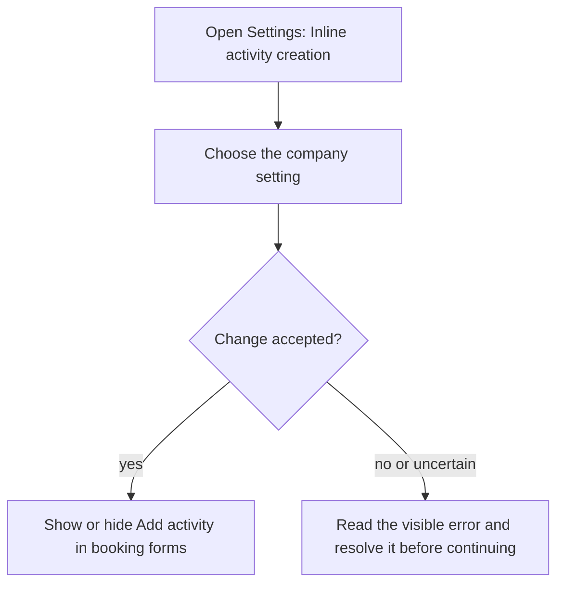
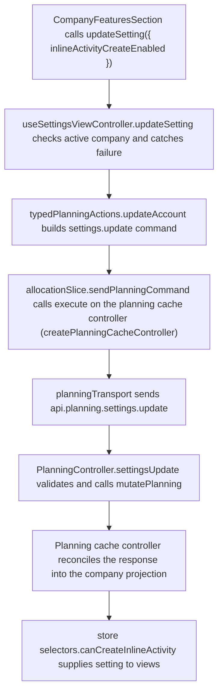

# US-SET-23 — Create activities inline

As a company Editor, I want to enable inline activity creation so that I can add an activity while booking work.

**Status:** Current
**Access:** Owner, Admin, Editor
**Entry:** Settings → Scheduling features → Inline activity creation
**Documentation:** [Settings](../../docs-src/using/settings.md)
**Source:** [SettingsSchedulingSection.tsx](../../apps/frontend/src/components/settings/SettingsSchedulingSection.tsx)

## Acceptance criteria

| Field                    | Control | Required/default/conditions                                                |
| ------------------------ | ------- | -------------------------------------------------------------------------- |
| Inline activity creation | Switch  | Company-wide; Off by default; enables Add activity in the allocation form. |

## User flow

## Code flow

**Code references:** [SettingsSchedulingSection.tsx](../../apps/frontend/src/components/settings/SettingsSchedulingSection.tsx), [useSettingsViewController.ts](../../apps/frontend/src/components/settings/useSettingsViewController.ts), [typedPlanningActions.ts](../../apps/frontend/src/store/typedPlanningActions.ts), [allocationSlice.ts](../../apps/frontend/src/store/slices/allocationSlice.ts), [planningCacheController.ts](../../apps/frontend/src/data/planning/planningCacheController.ts), [planningTransport.ts](../../apps/frontend/src/data/planning/planningTransport.ts), [planning_routes.ts](../../apps/backend/start/planning_routes.ts), [planning_controller.ts](../../apps/backend/app/controllers/planning_controller.ts), [planning.ts](../../apps/backend/app/services/planning.ts), [selectors.ts](../../apps/frontend/src/store/selectors.ts)
