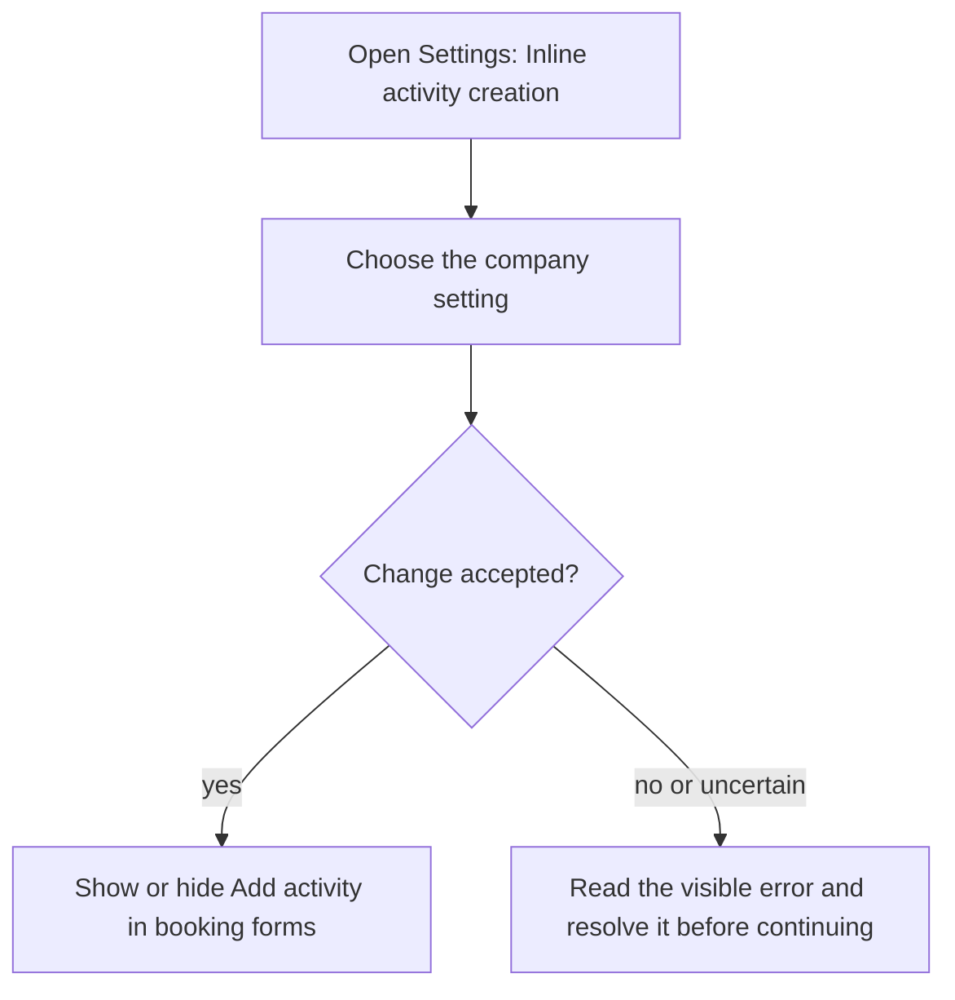
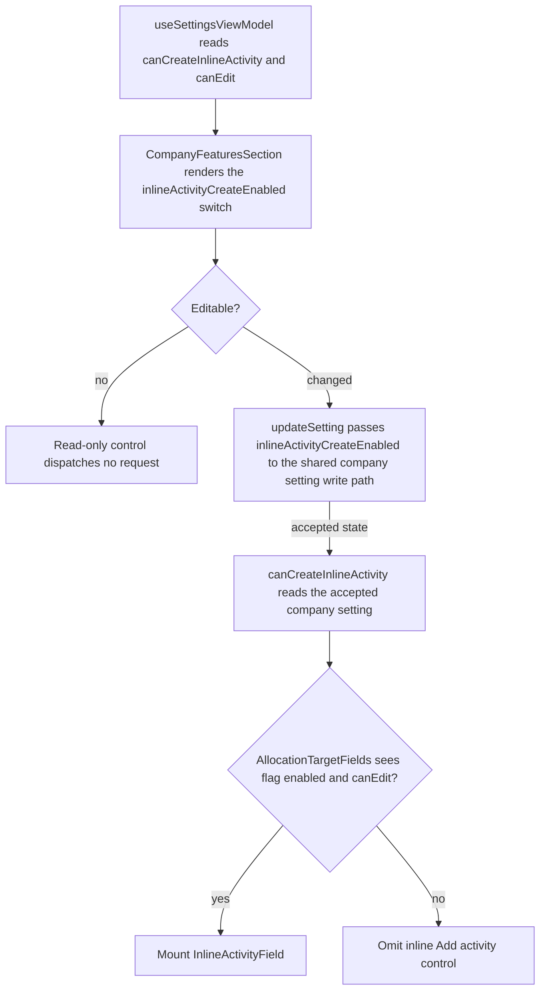

# US-SET-23 — Create activities inline

As a company Editor, I want to enable inline activity creation so that I can add an activity while booking work.

**Status:** Current
**Access:** Owner, Admin, Editor
**Entry:** Settings → Scheduling features → Inline activity creation
**Documentation:** [Settings](../../docs-src/using/settings.md)
**Source:** [SettingsSchedulingSection.tsx](../../apps/frontend/src/components/settings/SettingsSchedulingSection.tsx)

## Acceptance criteria

| Field                    | Control | Required/default/conditions                                                |
| ------------------------ | ------- | -------------------------------------------------------------------------- |
| Inline activity creation | Switch  | Company-wide; Off by default; enables Add activity in the allocation form. |

## User flow

## Code flow

The [company setting write path](../REFERENCE.md#company-setting-writes) traces the common no-op, server commit, refusal and reconciliation branches.

**Code references:** [useSettingsViewModel.ts:55](../../apps/frontend/src/components/settings/useSettingsViewModel.ts#L55) · [SettingsSchedulingSection.tsx:175](../../apps/frontend/src/components/settings/SettingsSchedulingSection.tsx#L175) · [selectors.ts:69](../../apps/frontend/src/store/selectors.ts#L69) · [useAllocationDialogState.ts:92](../../apps/frontend/src/components/scheduler/useAllocationDialogState.ts#L92) · [AllocationTargetFields.tsx:192](../../apps/frontend/src/components/scheduler/AllocationTargetFields.tsx#L192)
