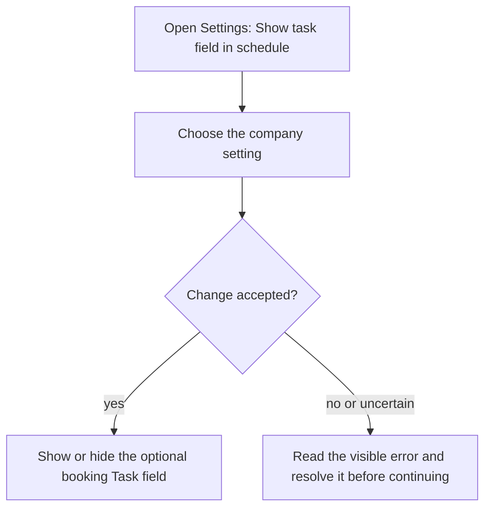
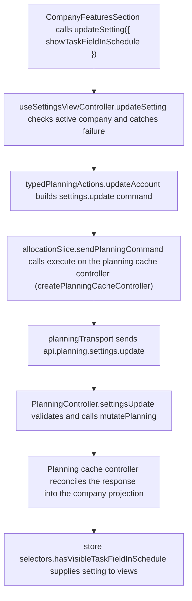

# US-SET-24 — Show the Task field

As a company Editor, I want to show the Task field so that a booking can carry a short task description.

**Status:** Current
**Access:** Owner, Admin, Editor
**Entry:** Settings → Scheduling features → Show task field in schedule
**Documentation:** [Settings](../../docs-src/using/settings.md)
**Source:** [SettingsSchedulingSection.tsx](../../apps/frontend/src/components/settings/SettingsSchedulingSection.tsx)

## Acceptance criteria

| Field                       | Control | Required/default/conditions                                        |
| --------------------------- | ------- | ------------------------------------------------------------------ |
| Show task field in schedule | Switch  | Company-wide; Off by default; hiding preserves existing Task text. |

## User flow

## Code flow

The persisted server path is shown; the temporary demo applies these planning commands in memory.

**Code references:** [SettingsSchedulingSection.tsx](../../apps/frontend/src/components/settings/SettingsSchedulingSection.tsx), [useSettingsViewController.ts](../../apps/frontend/src/components/settings/useSettingsViewController.ts), [typedPlanningActions.ts](../../apps/frontend/src/store/typedPlanningActions.ts), [allocationSlice.ts](../../apps/frontend/src/store/slices/allocationSlice.ts), [planningCacheController.ts](../../apps/frontend/src/data/planning/planningCacheController.ts), [planningTransport.ts](../../apps/frontend/src/data/planning/planningTransport.ts), [planning_routes.ts](../../apps/backend/start/planning_routes.ts), [planning_controller.ts](../../apps/backend/app/controllers/planning_controller.ts), [planning.ts](../../apps/backend/app/services/planning.ts), [selectors.ts](../../apps/frontend/src/store/selectors.ts)
