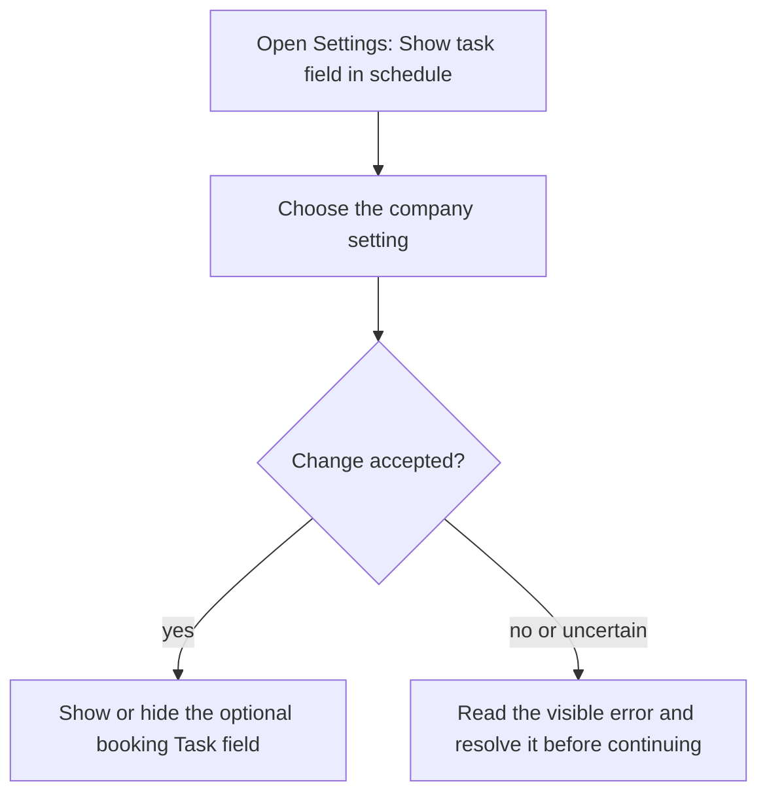
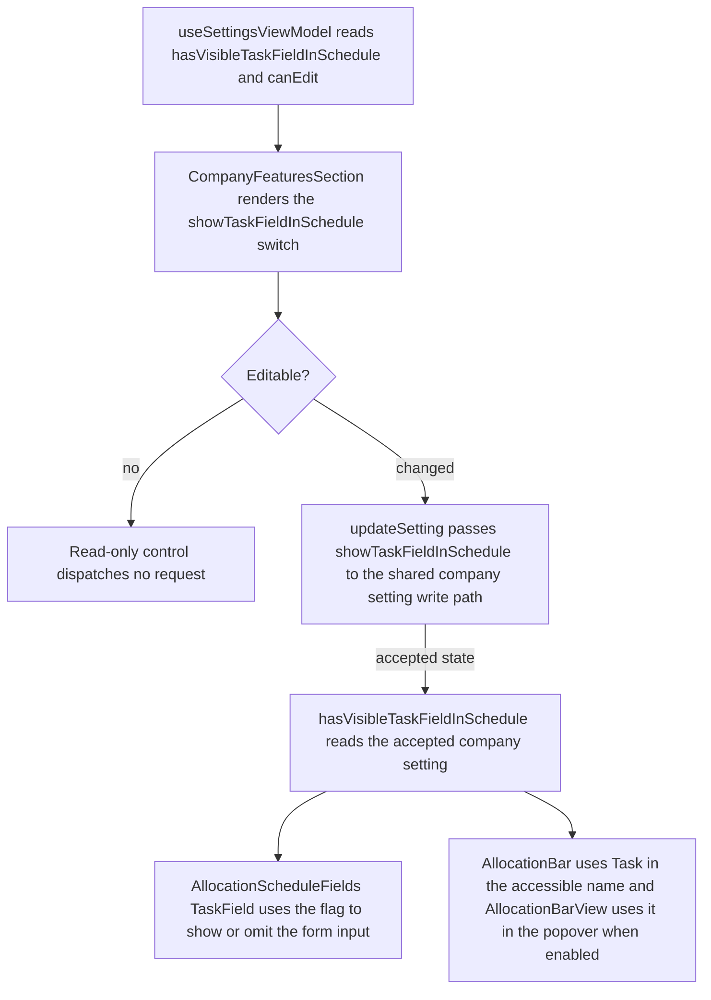

# US-SET-24 — Show the Task field

As a company Editor, I want to show the Task field so that a booking can carry a short task description.

**Status:** Current
**Access:** Owner, Admin, Editor
**Entry:** Settings → Scheduling features → Show task field in schedule
**Documentation:** [Settings](../../docs-src/using/settings.md)
**Source:** [SettingsSchedulingSection.tsx](../../apps/frontend/src/components/settings/SettingsSchedulingSection.tsx)

## Acceptance criteria

| Field                       | Control | Required/default/conditions                                        |
| --------------------------- | ------- | ------------------------------------------------------------------ |
| Show task field in schedule | Switch  | Company-wide; Off by default; hiding preserves existing Task text. |

## User flow

## Code flow

The [company setting write path](../REFERENCE.md#company-setting-writes) traces the common no-op, server commit, refusal and reconciliation branches.

**Code references:** [useSettingsViewModel.ts:55](../../apps/frontend/src/components/settings/useSettingsViewModel.ts#L55) · [SettingsSchedulingSection.tsx:183](../../apps/frontend/src/components/settings/SettingsSchedulingSection.tsx#L183) · [selectors.ts:76](../../apps/frontend/src/store/selectors.ts#L76) · [AllocationScheduleFields.tsx:45](../../apps/frontend/src/components/scheduler/AllocationScheduleFields.tsx#L45) · [AllocationBar.tsx:72](../../apps/frontend/src/components/scheduler/AllocationBar.tsx#L72) · [AllocationBarView.tsx:214](../../apps/frontend/src/components/scheduler/AllocationBarView.tsx#L214)
