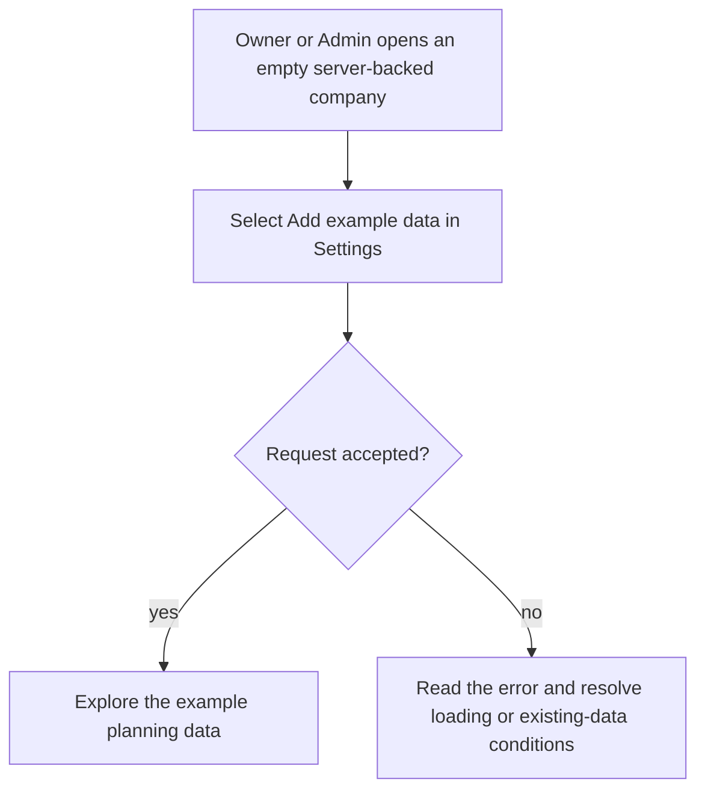
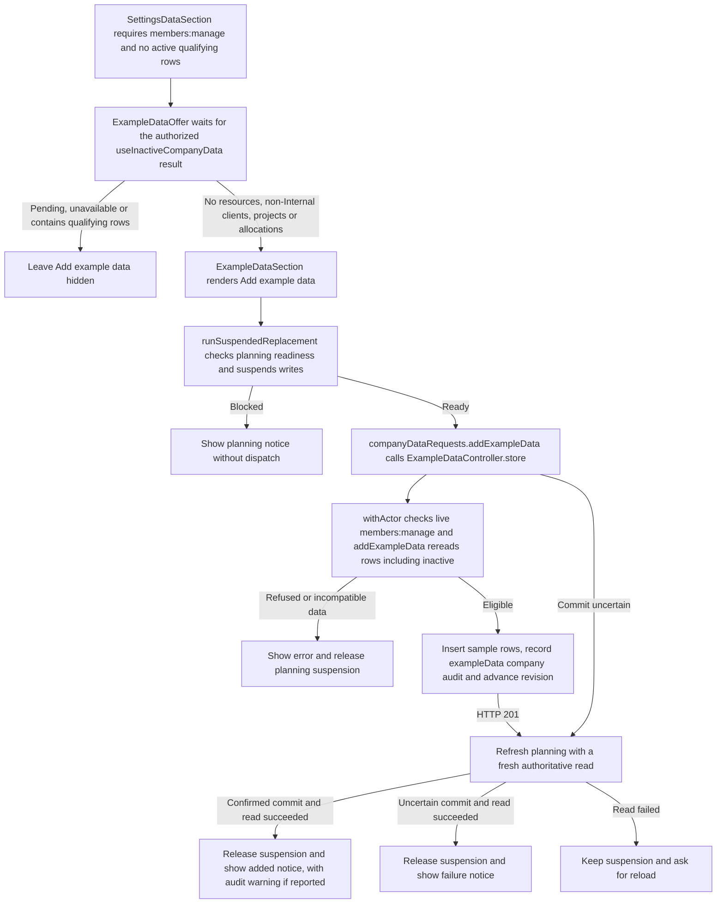

# US-SET-25 — Add example data

As an Owner or Admin, I want to add example data to an empty company so that I can explore a working setup.

**Status:** Current
**Access:** Owner, Admin
**Entry:** Settings → Data and support → Add example data
**Documentation:** [Settings](../../docs-src/using/settings.md)
**Source:** [SettingsDataSection.tsx](../../apps/frontend/src/components/settings/SettingsDataSection.tsx)

## Acceptance criteria

- **Add example data** is available to Owner/Admin on an empty server-backed company, excluding the built-in Internal client. It adds the fictional example dataset.
- The action is unavailable once the company has any resource, client other than Internal, project or allocation, including archived or deleted ones; the server refuses the request in that case.

## User flow

## Code flow

**Code references:** [SettingsDataSection.tsx](../../apps/frontend/src/components/settings/SettingsDataSection.tsx#L18) · [SettingsDataSection.tsx](../../apps/frontend/src/components/settings/SettingsDataSection.tsx#L28) · [SettingsDataSection.tsx](../../apps/frontend/src/components/settings/SettingsDataSection.tsx#L72) · [SettingsDataSection.tsx](../../apps/frontend/src/components/settings/SettingsDataSection.tsx#L110) · [useInactiveCompanyData.ts](../../apps/frontend/src/hooks/useInactiveCompanyData.ts#L74) · [company_state_controller.ts](../../apps/backend/app/controllers/company_state_controller.ts#L12) · [example_data_controller.ts](../../apps/backend/app/controllers/example_data_controller.ts#L6) · [example_data.ts](../../apps/backend/app/services/example_data.ts#L26) · [SettingsDataSection.test.tsx](../../apps/frontend/src/components/settings/SettingsDataSection.test.tsx#L129) · [suspendedReplacement.ts](../../apps/frontend/src/store/suspendedReplacement.ts#L54)
